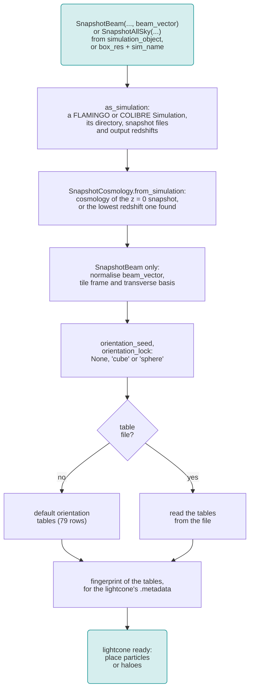

# Workflow of `SnapshotLightcone`

`SnapshotBeam` and `SnapshotAllSky` build lightcones from the snapshots of the FLAMINGO and COLIBRE simulations. 
For SWIFTLET v0.1.0-alpha, the diagrams below show: 

1. **[Setting up a lightcone](#1-setting-up-a-lightcone):** the simulation, its cosmology and the orientation tables of the box tiles.
2. **[Placing particles](#2-placing-particles):** `place_snapshot_particles_in_shell`, or `gather_files` and `place_file_in_shell` to place the files one at a time. Each particle type is placed in two stages:
    - **Gather:** find the files and cells to read, without reading any particle data. The snapshots filling the shell are chosen first, filling any gaps in redshift left by missing snapshots. For each snapshot, the cell centres are moved into each tile, and only the cells inside the shell (and beam) are kept, giving a list of `FileReadSpec`s, one per (snapshot, tile, file).
    - **Read and place:** read only the particles of those cells, apply the tile's transform, and keep the particles exactly inside the shell.
3. **[Placing haloes](#3-placing-haloes):** `gather_halo_catalogues` and `place_halos_in_shell`, which place the haloes of the SOAP catalogues exactly as particles are placed.

## 1. Setting up a lightcone

## 2. Placing particles

```mermaid
%%{init: {"htmlLabels": false, "themeVariables": {"fontFamily": "arial, helvetica, sans-serif", "fontSize": "14px"}, "flowchart": {"htmlLabels": false, "wrappingWidth": 400, "padding": 30, "nodeSpacing": 40, "rankSpacing": 45}}}%%
flowchart TD
    A("place_snapshot_particles_in_shell(<br/>z_range, property_names,<br/>ang_radius_deg, particle_types,<br/>use_snapshots, comm)") --> C
    A2("gather_files(ptype, z_range,<br/>ang_radius_deg)<br/>serial only") --> E0
    C["validate ang_radius_deg:<br/>SnapshotBeam needs one,<br/>SnapshotAllSky none.<br/>Serial if comm is None"] --> D

    D{{"for each<br/>particle type"}} --> E0

    subgraph SNAPS ["Choose the snapshots"]
        E0{"use_<br/>snapshots?"} -- no --> E1["snapshots_for_shell:<br/>which snapshots are on disk<br/>(file 0, looked for once)"]
        E1 --> E2{"gap of 0.1<br/>or more?"}
        E2 -- "yes: snapshots too<br/>far apart" --> EX["ValueError,<br/>before anything is read"]
        E2 -- no --> E3{"any<br/>missing?"}
        E3 -- yes --> E4["SnapshotGapWarning:<br/>the available snapshots<br/>fill the gaps, each nearest<br/>in redshift to its own"] --> E6
        E3 -- no --> E6
        E0 -- yes --> E5["FileNotFoundError if missing,<br/>SnapshotGapWarning for<br/>gaps left (not filled)"] --> E6
        E6["drop snapshots<br/>outside the shell"]
    end

    E6 --> F

    subgraph GATHER ["Stage 1, gather"]
        F{{"for each<br/>snapshot"}} --> G
        G["clip its redshift range<br/>to the shell, load its cell<br/>metadata and which files<br/>hold the particle type"] --> H
        H["find the box tiles<br/>(nx, ny, nz) the shell<br/>or beam crosses"] --> H2
        H2{"sphere<br/>lock?"} -- yes --> H3["split the tiles<br/>into spherical layers,<br/>each with its own<br/>redshift range"] --> I
        H2 -- no --> I
        I{{"for each<br/>tile"}} --> J
        J["tile orientation from a hash<br/>of (tile or layer, seed):<br/>rotation, reflection,<br/>periodic cell shift"] --> K
        K["transform the cell centres<br/>and move them to<br/>the tile's position"] --> L
        L["keep the cells inside<br/>the tile's part of the shell<br/>(buffer of one cell length)"] --> M
        M["record a FileReadSpec<br/>(snapshot, tile, file,<br/>offsets, lengths) for each<br/>file with particles"]
    end

    M --> N{"any<br/>particles?"}
    N -- no --> Z0["empty dict for<br/>this particle type"]
    N -- "yes, from<br/>gather_files" --> FB["return the FileReadSpecs,<br/>then place_file_in_shell(i)<br/>places one at a time"]
    N -- "yes, whole<br/>shell" --> O{"comm<br/>given?"}

    subgraph READ ["Stage 2, read and place"]
        O -- "no (serial)" --> P["all FileReadSpecs<br/>on one process"]
        O -- "yes (MPI)" --> P2["a block of FileReadSpecs<br/>on each rank<br/>(phdf5.assign_files)"]
        P --> Q
        P2 --> Q
        Q{{"for each<br/>FileReadSpec"}} --> R
        R["read only the cells' particles:<br/>Coordinates, ParticleIDs,<br/>SmoothingLengths (not DM)<br/>and property_names"] --> S
        S["apply the tile transform<br/>to the coordinates<br/>(Velocities etc. are<br/>not re-oriented)"] --> T
        T["keep the particles exactly<br/>inside the tile's part<br/>of the shell, add<br/>SnapshotNumber"]
    end

    FB --> Q
    T --> U["concatenate the kept particles<br/>(MPI: empty arrays on<br/>ranks without files)"]
    U --> V["attach ExpansionFactors<br/>from comoving distance"]
    V --> W{"rebalance<br/>ranks?"}
    W -- "yes: redistribute_<br/>particles" --> W2["repartition the particles<br/>evenly between the ranks"] --> X
    W -- no --> X
    Z0 --> X
    X["particle data<br/>for this type"] --> D

    D -- "all types<br/>done" --> Y["lightcone_metadata(<br/>z_range, ang_radius_deg)"]
    Y --> Z("return<br/>LightconeOutput<br/>{ptype: data}<br/>with its .metadata")

    classDef loop fill:#F1EFE8,stroke:#333;
    classDef out fill:#d6eeee,stroke:darkcyan;
    classDef err fill:#f6dcdc,stroke:#a33;
    class D,F,I,Q loop;
    class A,A2,Z,FB out;
    class EX err;
```

A file needed by several tiles is read once for each tile (one `FileReadSpec` each). With the `"sphere"` lock, a tile crossing a sphere is read once for each layer.

## 3. Placing haloes

```mermaid
%%{init: {"htmlLabels": false, "themeVariables": {"fontFamily": "arial, helvetica, sans-serif", "fontSize": "14px"}, "flowchart": {"htmlLabels": false, "wrappingWidth": 400, "padding": 30, "nodeSpacing": 40, "rankSpacing": 45}}}%%
flowchart TD
    A("place_halos_in_shell(<br/>halo_format, z_range,<br/>ang_radius_deg, use_snapshots,<br/>soap_chunk_size, comm,<br/>redistribute_halos)") --> B
    A2("gather_halo_catalogues(<br/>halo_format, z_range,<br/>ang_radius_deg)<br/>dry run: no haloes read") --> G0
    B["validate ang_radius_deg,<br/>comm = COMM_WORLD if None<br/>and more than one rank"] --> C
    C{"already<br/>gathered?"} -- no --> G0
    C -- "yes, same<br/>settings" --> P

    subgraph GATHER ["Gather"]
        G0["choose the snapshots<br/>as for particles, from the<br/>SOAP catalogues on disk<br/>(gaps filled with a warning,<br/>ValueError if 0.1 apart)"] --> G1
        G1["box and cell metadata<br/>from one snapshot only<br/>(highest redshift one used<br/>with its file 0 on disk)"] --> G2
        G2{{"for each<br/>snapshot"}} --> G3
        G3["clip its redshift range<br/>to the shell, find the tiles<br/>(and spherical layers)<br/>the shell or beam crosses"] --> G4
        G4["record a HaloCatalogueSpec<br/>(snapshot, tile, catalogue,<br/>z range) per tile, and the<br/>catalogue's number of haloes"]
    end

    G4 --> GX{"dry run<br/>only?"}
    GX -- "yes: gather_halo_<br/>catalogues" --> GY("return the<br/>HaloCatalogueSpecs")
    GX -- no --> P

    subgraph READ ["Read and place"]
        P["split the catalogues<br/>into pieces of<br/>soap_chunk_size rows"] --> P1{"comm<br/>given?"}
        P1 -- "no (serial)" --> P2["all pieces<br/>on one process"]
        P1 -- "yes (MPI)" --> P3["at least one piece<br/>per rank, shared<br/>between the ranks"]
        P2 --> Q
        P3 --> Q
        Q{{"for each<br/>piece"}} --> R
        R["read HaloCentre and<br/>HaloCatalogueIndex<br/>of its rows, once"] --> S
        S{{"for each tile of<br/>its snapshot"}} --> T
        T["apply the tile transform<br/>to the halo centres,<br/>as for particles"] --> U
        U["keep the haloes exactly<br/>inside the tile's part of<br/>the shell, record the snapshot,<br/>HaloCatalogueIndex and<br/>SOAPIndex (the row)"]
    end

    U --> V{"rebalance<br/>ranks?"}
    V -- "yes: redistribute_<br/>halos" --> V2["repartition the haloes<br/>evenly between the ranks"] --> W
    V -- no --> W
    W["attach ExpansionFactor<br/>from comoving distance"] --> Z
    Z("return LightconeOutput:<br/>Lightcone/HaloCentre,<br/>Lightcone/ExpansionFactor,<br/>Lightcone/SnapshotNumber,<br/>InputHalos/HaloCatalogueIndex,<br/>InputHalos/SOAPIndex<br/>with its .metadata")

    classDef loop fill:#F1EFE8,stroke:#333;
    classDef out fill:#d6eeee,stroke:darkcyan;
    class G2,Q,S loop;
    class A,A2,Z,GY out;
```

Unlike the particles, each SOAP catalogue is read once and haloes are placed in every tile where it overlaps with the corresponding snapshot redshift range. As the SOAP catalogues are not sorted by cells every halo must be spatially queried.
The haloes in the `SnapshotLightcone` can be mapped back to original SOAP catalogue and all its associated properties properties via `Lightcone/SnapshotNumber` and `InputHalos/SOAPIndex`.
