# Workflow of `place_snapshot_particles_in_shell`

For each particle type `SnapshotBeam` and `SnapshotAllSky` (subclasses of `SnapshotLightcone`) place snapshot particles in a lightcone (`swiftlet/snapshot_lightcone.py`) in two stages:

1. **Gather:** finds the files and cells to read, without reading any particle data. For each snapshot, the cell centres are moved into each tile and only the cells inside the lightcones redshift range (and beam) are kept, giving a list of `FileReadSpec`s.

2. **Read and place:** only reads the particles from those cells, applies the tile's transforms, and keeps the particles exactly inside the lightcone. 

If the cells kept hold no particles of a type, an empty result is returned for that type.

```mermaid
flowchart TD
    A(["SnapshotBeam / SnapshotAllSky(box_res, sim_name, beam_vector,<br/>orientation_seed, orientation_lock)"]) --> B
    B["place_snapshot_particles_in_shell(z_range, ang_radius_deg,<br/>property_names, particle_types, comm)"] --> C
    C["validate ang_radius_deg<br/>set MPI mode (serial if comm is None)"] --> D

    D{{"for each particle type"}} --> E

    subgraph GATHER ["1. Gather: which files and cells to read (no particle data read)"]
        E["choose snapshots whose redshift range overlaps the shell<br/>(or use_snapshots)"] --> F
        F{{"for each snapshot"}} --> G
        G["clip the snapshot's redshift range to the shell<br/>load its cell metadata (centres, offsets, lengths, files)"] --> H
        H["find the box tiles (nx, ny, nz) the shell / beam crosses<br/>_tiles_intersecting_shell"] --> H2
        H2{"orientation_lock == 'sphere'?"} -- yes --> H3["split tiles into spherical layers,<br/>each with its own redshift range"] --> I
        H2 -- no --> I
        I{{"for each tile"}} --> J
        J["tile orientation from hash of (tile or lock layer, seed):<br/>rotation, reflection, periodic cell shift"] --> K
        K["transform the cell centres and move them to the tile's position"] --> L
        L["keep cells inside the shell / beam<br/>(_in_shell, padded by half a cell diagonal)"] --> M
        M["record FileReadSpec(snapshot, tile, file, offsets, lengths)<br/>for each file with particles in those cells"]
    end

    M --> N{"any particles<br/>in the selected cells?"}
    N -- no --> Z0["empty dict for this particle type"]
    N -- yes --> O{"comm given?"}

    subgraph READ ["2. Read and place"]
        O -- "no (serial)" --> P["all FileReadSpecs on one process"]
        O -- "yes (parallel)" --> P2["split the FileReadSpecs between the MPI ranks"]
        P --> Q
        P2 --> Q
        Q{{"for each FileReadSpec"}} --> R
        R["read only the selected cells' particles<br/>(merged offsets / lengths)"] --> S
        S["apply the same tile transform to the particle coordinates"] --> T
        T["keep particles exactly inside the shell / beam<br/>add SnapshotNumber"]
    end

    T --> U["concatenate the kept particles<br/>(parallel: fill empty ranks with zero-length arrays)"]
    U --> V["attach ExpansionFactors from comoving distance"]
    V --> W{"redistribute_particles?"}
    W -- yes --> W2["repartition the particles evenly between the ranks"] --> X
    W -- no --> X
    Z0 --> X
    X["particle data for this type"] --> D

    D -- "all types done" --> Y["lightcone_metadata(z_range, ang_radius_deg)"]
    Y --> Z(["return LightconeOutput {ptype: data} + .metadata"])

    classDef loop fill:#F1EFE8,stroke:#333;
    classDef out fill:#d6eeee,stroke:darkcyan;
    class D,F,I,Q loop;
    class A,Z out;
```

