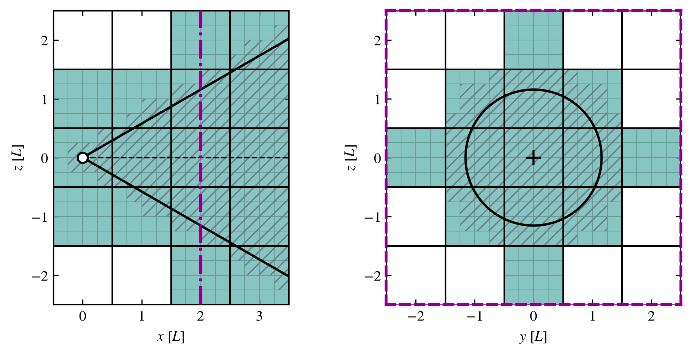

Building lightcones
===================

.. currentmodule:: swiftlet.snapshot_lightcone

This page covers how to build a lightcone with :mod:`swiftlet`, this includes an overview of how to use the
:mod:`swiftlet.snapshot_lightcone` module and a :ref:`step-by-step <lightcone-step-by-step>` 
walkthrough of the main methods in the :class:`SnapshotLightcone` class that is used to build lightcones.
See :doc:`methods_overview` for an overview of the main ideas behind how lightcones are built in :mod:`swiftlet`. 

All lightcones in :mod:`swiftlet` are classified as either an :term:`all-sky <all-sky lightcone>` or :term:`beam` 
lightcone. The former are lightcones whose footprint that covers the whole sky (i.e., a solid angle of :math:`4 \pi` 
steradians) and are built with :class:`SnapshotAllSky` class. The latter, are lightcones given by a circular beam 
with an angular radius less than 60 degrees (or a solid angle of :math:`\leq \pi` steradians) and are 
constructed with the :class:`SnapshotBeam` class. 

Both :class:`SnapshotAllSky` and :class:`SnapshotBeam` are subclasses of :class:`SnapshotLightcone`, and only contain 
information specific to the geometry of the lightcones they build. 
The methods used for building a lightcone are held by :class:`SnapshotLightcone` and are therefore shared by both 
subclasses. As shown in :doc:`methods_overview`, :mod:`swiftlet` builds lightcones by taking copies of the simulations 
snapshot box and placing them into a lattice around the observer, before then populating the lattice using slices of 
particle and haloes from snapshots chosen by their redshift (comoving distance from the observer). 

.. _lightcone_building_step_list:

In practice :class:`SnapshotLightcone` builds lightcones in main three steps:

#.  **Defining the lightcone**: choose the simulation, the lightcone's geometry (an :term:`all-sky lightcone` or 
    :term:`beam`) and its internal structure (how the copies of the snapshot box are :term:`oriented <orientation>`).
#.  **Gather**: build the lattice containing the lightcone at the :term:`cell` level and mapping each cell the lightcone 
    passes through to the same cell in a snapshot that is output at the redshift corresponding to the comoving distance 
    from the observer in the lightcone. This step finds the exact files and cells to read without ever touching the 
    particle or halo data. 
#.  **Read and place**: read the particles or haloes of those cells, keeping only those within the lightcone and place 
    them into the lightcone, following the blueprint laid out by the previous step.

.. important::
   **Lightcones should be built in thin redshift shells:**
   the comoving volume of a lightcone quickly grows larger than that of a snapshot. For example, with the COLIBRE
   ``L400_m7`` simulations, an all-sky lightcone for redshifts :math:`z=0 - 0.2` (a comoving radius of 
   :math:`\approx 838` Mpc) holds the comoving volume, and disk space, of :math:`\approx 39` snapshots.

.. _define-lightcone:

Defining a lightcone
--------------------

To define a lightcone it needs:

*   **the simulation**: a :class:`Simulation <swiftlet.simulation_suites.Simulation>` object, passed as 
    ``simulation`` (see :doc:`new_simulations_and_suites`)
*   **its geometry**: handled by the :class:`SnapshotLightcone` subclasses, :class:`SnapshotAllSky` and 
    :class:`SnapshotBeam`, which needs a direction (``beam_vector``) and angular radius (``ang_radius_deg``).
*   **the orientation of its tiles**: the ``orientation_table`` (the default table is used if one is not specified), the
    ``orientation_lock`` (``none``, ``"cube"`` or ``"sphere"``) and the ``orientation_seed`` (see :doc:`orientation`
    and :doc:`orientation_tables`). 

.. code-block:: python

    from swiftlet import Simulation, SnapshotAllSky, SnapshotBeam

    sim = Simulation.from_label("L0400N3008", "Thermal")   # COLIBRE L400_m7, Thermal AGN

    
    # define a beam lightcone
    beam = SnapshotBeam(
        simulation=sim, 
        beam_vector=(1., 2., 3.),       # pointing of the beam
        ang_radius_deg=2.0,             # angular radius of the beam, in degree
        orientation_table='default',    # use the default installed tables
        orientation_lock="cube",        # how to configure layers tiles in the lightcones lattice
        orientation_seed=0,             # order of reading the rows of the orientation tables
        )

    # define an all-sky lightcone, the same as the beam but for the whole sky
    all_sky = SnapshotAllSky(
        simulation=sim, 
        orientation_lock="cube", 
        orientation_seed=0,
        )

With the same internal structure (set by the :term:`orientation tables <orientation table>`, 
:term:`lock <orientation lock>` and :term:`seed <orientation seed>`; see :doc:`orientation`) and 
:term:`observer position` (see :ref:`observer-position`), ``beam`` in the code block above gives the exact same 
lightcone as the same cone shaped subvolume within ``all_sky`` (see :ref:`beams-are-part-of-the-all-sky-lightcone`).

.. tip::
   Before building a large lightcone it is a good idea to check how close periodic replicas will be within the 
   lightcone. This can be done at the cell level with 
   :func:`find_close_cell_repeats <swiftlet.repeat_check.find_close_cell_repeats>` (see :doc:`repeated_objects`).

Populating a lightcone
----------------------

A lightcone is filled one redshift shell at a time, with particles or haloes, by the gather and the read and place
steps above.

A lightcone is populated with particles or haloes one shell at a time (described in :doc:`methods_overview`), by 
the :term:`gather <gather step>` and the :term:`read and place <read and place step>` steps from the 
:ref:`list <lightcone_building_step_list>` above.

The diagram below sketches out what the end result of the gather step looks like for a lightcone :term:`beam`. 

.. _fig-cell_selection:

   The tiles added to the lattice and the cells that the lightcone passes through are shaded and hatched, respectively. 
   Left: The xz plane, showing the line along the beam. Right: The zy plane, showing the cross section of the beam 
   indicated by the magenta line on the left panel. 

The methods that do both steps at once are:

.. list-table::
   :header-rows: 1
   :widths: 40 60

   * - Method
     - Places

   * - :meth:`SnapshotLightcone.place_snapshot_particles_in_shell`
     - the particles of one or more particle types, with the requested properties. The particles ``Coordinates``,
       ``ExpansionFactors``, ``SnapshotNumber`` and ``ParticleIDs`` are always tracked (``SmoothingLengths`` 
       are included for every type but dark matter, ``PartType1``). ``Velocities``, if asked for, are re-oriented with 
       the coordinates

   * - :meth:`SnapshotLightcone.place_halos_in_shell`
     - the haloes of the :term:`SOAP catalogues <SOAP catalogue>`, at the paths of the simulation's ``soap_format`` (see
       :ref:`simulation parameters <table-of-values>`), with the properties needed to find each halo in its catalogue 
       (see :doc:`halo_lightcones`)

Both methods can work with MPI to share the work between ranks (see :doc:`parallel_and_hpc`).

If a **simulation's snapshot is missing on disk** then snapshots next to it cover its redshift range, as long as the 
snapshots are less than 0.1 apart in redshift by default. Any time this occurs a :class:`SnapshotGapWarning` is given. 

.. _max-snapshot-spacing:

Snapshot redshifts and missing snapshots
^^^^^^^^^^^^^^^^^^^^^^^^^^^^^^^^^^^^^^^^^

A lightcone is filled by the snapshots whose redshift ranges cover the lightcones comoving distance, each filling the 
redshifts between the midpoints to its neighbours (see :doc:`methods_overview` and :doc:`new_simulations_and_suites`). 
Snapshots missing on disk are filled by the available ones and you are warned each time this happens with a 
:class:`SnapshotGapWarning <swiftlet.snapshot_lightcone.SnapshotGapWarning>`. By default if the snapshots are 0.1 or 
more apart in redshift (:math:`\Delta z =0.1`), a ``ValueError`` is raised before any data is read.

:envvar:`SWIFTLET_MAX_SNAPSHOT_SPACING` sets another limit and can be changed if needed:

.. code-block:: bash

    export SWIFTLET_MAX_SNAPSHOT_SPACING=0.22     # for one shell or job script

.. code-block:: python

    import os
    os.environ["SWIFTLET_MAX_SNAPSHOT_SPACING"] = "0.22"

    from swiftlet.snapshot_redshifts import max_snapshot_spacing
    max_snapshot_spacing()                         # the limit used: 0.22

.. caution::

    **Keep the snapshot spacing small.** Increasing the distance in redshift between the snapshots filling a lightcone 
    will increase the severity of the discontinuities when one snapshot meets another.  
    Raising :envvar:`SWIFTLET_MAX_SNAPSHOT_SPACING` above its default of 0.1 is not advised and there is a hard limit of
    0.25. 

The output redshifts of FLAMINGO and COLIBRE are themselves spaced more widely at high redshift, so the limit also sets
the maximum redshift of a lightcone for these simulations. For a maximum snapshot redshift spacing of 0.1
(:math:`\Delta z =0.1`), FLAMINGO and COLIBRE can build lightcones out to :math:`z=3.0`, however if 
:envvar:`SWIFTLET_MAX_SNAPSHOT_SPACING` is increased to :math:`\Delta z =0.25` then the lightcones can be extended out 
to :math:`z=5.0` and :math:`10`, respectively. 

.. _placing-files-one-at-a-time:

Placing files one at a time
^^^^^^^^^^^^^^^^^^^^^^^^^^^

A lightcone or even the shell populated by one snapshot can hold more particles than fit in memory. 
:meth:`SnapshotLightcone.gather_files` runs the gather step alone, for one particle type, and returns the files to read:
one :class:`FilePlan` for each snapshot file, with every tile that uses it.
:meth:`SnapshotLightcone.place_file_in_shell` then reads and places one file at a time, so each can be added to a map
and dropped:

.. code-block:: python

    nr_files, files = beam.gather_files("PartType1", (0.1, 0.2))
    for file_number in range(nr_files):
        particles = beam.place_file_in_shell(file_number, "PartType1", ["Masses"])
        if len(particles):
            ...  # add particles["Coordinates"] and particles["Masses"] to a map

**Each file is read once.** A cell used by several tiles (e.g. for all-sky lightcones, tiles around the observer
share the same snapshot's cells) is read once and its particles are placed in each tile. The particles placed this way 
are the same as those of :meth:`place_snapshot_particles_in_shell <SnapshotLightcone.place_snapshot_particles_in_shell>` 
for the same lightcone. :meth:`place_file_in_shell <SnapshotLightcone.place_file_in_shell>` places the files of the last
:meth:`gather_files <SnapshotLightcone.gather_files>` call. Each :class:`FilePlan` gives the number of particles to 
read (``nr_particles``, each cell once) and to place (``nr_placed``, each cell once per tile using it), e.g. to share 
the files between processes.

The options of the placing methods:

.. list-table::
   :header-rows: 1
   :widths: 30 70

   * - Option
     - Effect

   * - ``tile=``
     - :meth:`place_file_in_shell <SnapshotLightcone.place_file_in_shell>` places only the particles of one tile,
       ``(nx, ny, nz)`` (or ``(nx, ny, nz, layer)`` for one layer with a ``"sphere"`` lock). Leave ``tile=None`` (the 
       default) to read each file once and have each file read place particles in all tiles it's particles are found in. 

   * - ``max_particles_per_read=``
     - reads a file in batches of at most this many particles (whole cells, so a cell with more is read on its own),
       on every placing method. This can be used to lower the peak memory required when reading a file. 

   * - ``"TileIndex"`` in ``property_names``
     - each particle also stores its tile, ``(nx, ny, nz)`` (or ``(nx, ny, nz, layer)`` with the ``"sphere"`` lock) as a
       properties. Without it, no ``TileIndex`` is returned.

Each file can then be broken down further again with :meth:`SnapshotLightcone.iter_file_pieces`, which returns the
particles in a file one batch (of at most ``max_particles_per_read``) at a time, as soon as the particles are placed in 
the lightcone. Meaning you never need to hold all of the particles in a single file at once. 
Iterating with this function is the same as calling :meth:`place_file_in_shell <SnapshotLightcone.place_file_in_shell>` 
with the same arguments:

.. code-block:: python

    nr_files, files = beam.gather_files("PartType1", (0.1, 0.2))
    for file_number in range(nr_files):
        for piece in beam.iter_file_pieces(file_number, "PartType1", ["Masses"], max_particles_per_read=10**7):
            ...  # add piece["Coordinates"] and piece["Masses"] to a map, then drop them

.. _lightcone-output:

.. _reading-remotely:

Reading a simulation remotely
^^^^^^^^^^^^^^^^^^^^^^^^^^^^^

A simulation's snapshots and SOAP catalogues can be read from an hdfstream server (with the ``hdfstream`` package) 
instead of storing the simulations datasets on disk. Currently this is only available with FLAMINGO following its public
data release (for more information on hdfstream and accessing the public FLAMINGO data see 
`access FLAMINGO data products <https://dataweb.cosma.dur.ac.uk:8443/flamingo/service_docs/index.html>`_). 
To use hdfstream with :mod:`swiftlet`, open the server's directory and give it to
:meth:`Simulation.from_label <swiftlet.simulation_suites.Simulation.from_label>` as ``remote``. Everything else is the
same as on disk, and the same particles and haloes are placed:

.. code-block:: python

    import hdfstream
    from swiftlet import Simulation, SnapshotBeam

    remote_dir = hdfstream.open("cosma", "/FLAMINGO")         # the directory holding FLAMINGO's boxes
    sim = Simulation.from_label("L1000N1800", "L1_m9", remote=remote_dir)

    beam = SnapshotBeam(sim, beam_vector=(1, 2, 3), ang_radius_deg=2.0)
    particles = beam.place_snapshot_particles_in_shell((0.05, 0.15), ["Masses"], particle_types="PartType1")
    haloes = beam.place_halos_in_shell(None, (0.05, 0.15))     # None: the simulation's own SOAP catalogues

The simulation's directory on the server is ``{box_res}/{sim_name}`` relative to the directory opened. Note that on
the server FLAMINGOs **snapshot files are one directory deeper** (``snapshots/flamingo_0077/swift_snapshot_0077/...``).
This is accounted for by :mod:`swiftlet`, unless ``snapshot_format`` is given when defining the :class:`Simulation`.

**Requests to the server.** Every dataset is read with one request for all the rows it needs (all its cells, or a
batch of them), following the service's rules. The service asks for no more than 2 to 4 requests at once, so on MPI
ranks at most ``max_concurrent_requests`` requests (2 by default) are allowed at once across the ranks. For the
particles and the SOAP catalogues a serial call makes one request at a time, and snapshots on disk are never capped
(see :doc:`parallel_and_hpc`).

The output lightcones
---------------------

Each method returns a :class:`LightconeOutput`: a dictionary of `unyt` arrays, one row per particle or halo (for
particles, one :class:`LightconeOutput` per particle type), with the positions relative to the observer. Its
``.metadata`` records every setting that made it:

*   the lightcone type, the simulation (suite, label and name)
*   the ``orientation_seed``, ``orientation_lock``, the ``orientation_table`` and the :term:`fingerprint` of its 
    contents
*   the beam vector and angular radius, and the redshift range

Given the same settings and snapshots, the same lightcone is made again (see :doc:`orientation_tables`).
:func:`write_lightcone_metadata` and :func:`read_lightcone_metadata` write and read the metadata in HDF5 files, and
:func:`write_halo_lightcone_file` writes a halo lightcone in the format of the LightconeIO halo lightcones (see the
:doc:`../quickstart`).

.. _lightcone-step-by-step:

Building lightcones: Step by step
---------------------------------

What happens when a lightcone is being populated with particles or haloes, step by step.

Particles
^^^^^^^^^

.. dropdown:: Flowchart: placing particles into a lightcone
   :icon: workflow
   :animate: fade-in

   .. mermaid:: mermaid/snapshot_lightcone_particles.mmd
      :align: center
      :caption: Placing particles: choosing the snapshots, gathering the pieces to read, and reading and placing them.

:meth:`SnapshotLightcone.place_snapshot_particles_in_shell` places every particle type asked for; or
:meth:`SnapshotLightcone.gather_files` and :meth:`SnapshotLightcone.place_file_in_shell` place one particle type, one
file at a time. For each particle type:

**Choosing the snapshots**

#.  The snapshots filling the shell are chosen from their output redshifts, unless given with ``use_snapshots``. Each
    snapshot fills the redshifts between the midpoints to its neighbours.
#.  Snapshots missing on disk are filled by the available snapshots, each nearest in redshift to its own and a warning 
    is given with :class:`SnapshotGapWarning` (see :ref:`max-snapshot-spacing`).
#.  As a safety net, any snapshot whose redshift range lies outside the shell is dropped. The files of the snapshots
    given with ``use_snapshots`` must then be on disk (``FileNotFoundError`` otherwise), and the parts of the shell
    they leave unfilled are warned about with a :class:`SnapshotGapWarning`, but not filled.

Particles and haloes choose their snapshots in exactly the same way.

**Step 1, gather** (no particle data is read)

#.  For each snapshot, its redshift range is clipped to the lightcone, and its cell :term:`metadata` (cell centres, and 
    which files hold the particle type) is loaded.
#.  For each snapshot, its redshift range is clipped to the lightcone, and its cell metadata (the cell centres, the
    file itself, offset and number of particles of each cell for each particle type) is read from its file 0, once per 
    call. A snapshot without the particle type (e.g. no stars at high redshift) adds no files and a particle type in not 
    found in any of the snapshots raises a ``ValueError``.
#.  The tiles the lightcone passes through are found. With ``"sphere"``, the tiles crossing a :term:`layer` are
    split into one :term:`piece` (tile, snapshot) per layer, each with its own redshift range.
#.  For each tile, its orientation is read from the tables, from its position on the lattice (or its layer) and the
    seed. The periodic :term:`cell shift`, reflections and quarter turns are applied on each axis. 
#.  The cell centres are transformed and moved to the tile's position, and the cells inside the tile's part of the
    lightcone are kept (with a buffer of one cell length).
#.  Each file with particles in those cells is planned once, as a :class:`FilePlan` (snapshot, file, the offsets and
    lengths of its cells), with every tile that uses it (with ``"sphere"``, every layer of a tile crossing a sphere).

Everything the gather step finds (the snapshots, the pieces, the file plans, the cells of each piece and the snapshots' 
cell metadata) is recorded in a new :class:`ShellRead`, kept as the lightcone's ``last_shell`` until the next call. 
Nothing else is kept from one call to the next.

:meth:`gather_files <SnapshotLightcone.gather_files>` stops here, and returns the 
:class:`FilePlan`\ s for :meth:`place_file_in_shell <SnapshotLightcone.place_file_in_shell>` to 
place one at a time.

**Step 2, read and place**

#.  The planned files are read on one process, or shared whole between the MPI ranks. Each file is
    read by one rank, and the files are shared so each rank has approximatly the same number of particles to place
    (``FilePlan.nr_placed``, see :doc:`parallel_and_hpc`).

#.  Each file is opened once and its cells are read once for each dataset (one request when reading
    remotely, see :ref:`reading-remotely`).
#.  For each tile that uses particles from the given file, the ``Coordinates`` of the particles in the needed cells are 
    read and used to placed into the lightcone. Only particles exactly inside the tile's part of the lightcone are kept.
#.  The ``ParticleIDs`` and other properties asked for are read only for the cells keeping a particle. 
    Each particle's ``SnapshotNumber`` and ``TileIndex``, if asked for, is added to the particles properties. 
    ``Velocities``, if read, take the tile's reflection and rotation (not its periodic shift or position, which move 
    positions but not directions), so each velocity keeps its direction relative to its particle's surroundings.
#.  The kept particles are joined and their ``ExpansionFactors`` are computed from their comoving distance to the 
    observer.
#.  With MPI and ``redistribute=True``, the particles are shared evenly between the ranks.

The result is a :class:`LightconeOutput` ``{particle type: data}``, with the lightcone's ``.metadata``.

Haloes
^^^^^^

.. dropdown:: Flowchart: placing haloes into a lightcone
   :icon: workflow
   :animate: fade-in

   .. mermaid:: mermaid/snapshot_lightcone_haloes.mmd
      :align: center
      :caption:  Placing haloes from the SOAP catalogues.

:meth:`SnapshotLightcone.place_halos_in_shell` (with :meth:`SnapshotLightcone.gather_halo_catalogues` for its gather
step) places the haloes of the SOAP catalogues exactly as particles are placed (See :doc:`halo_lightcones` for further 
applications and examples). 

**Step 1, gather**

#.  The snapshots are chosen exactly the same as done for the particles, from the SOAP catalogues on disk (gaps filled
    with a warning, and a ``ValueError`` if they are 0.1 or more apart in redshift; see :ref:`max-snapshot-spacing`).
#.  The cell metadata are read from one snapshot only (it is the same in every snapshot).
#.  For each snapshot, its redshift range is clipped to the lightcone, and the tiles (and spherical layers) the 
    lightcone crosses are found.
#.  A :class:`HaloCatalogueSpec` (snapshot, tile, catalogue and redshift range) is recorded for each tile, with the 
    catalogue's number of haloes, in a :class:`HaloShellRead`. If the gather step has already been run with the same 
    arguments, it is not repeated.

**Step 2, read and place**

#.  The catalogues are split into chunks of ``soap_chunk_size`` rows, read on one process or shared between the MPI 
    ranks
#.  For each chunk, the halo centres and catalogue indices of its rows are read once.
#.  For each tile of its snapshot, the tile's transform is applied to the halo centres, as for particles, and the haloes
    exactly inside the tile's part of the shell are kept, with their snapshot, ``HaloCatalogueIndex`` and
    ``SOAPIndex`` (row in the catalogue).
#.  With MPI and ``redistribute_halos=True``, the haloes are shared evenly between the ranks.
#.  Each halo is assigned a ``Lightcone/ExpansionFactor`` based on its comoving distance from the observer. 

Unlike particles, each SOAP catalogue is read once, and its haloes placed in every tile where it fills the snapshot's
redshift range. SOAP catalogues are not sorted by cell, so every halo is tested. The result, a :class:`LightconeOutput`
with ``Lightcone/HaloCentre``, ``Lightcone/ExpansionFactor``, ``Lightcone/SnapshotNumber``,
``InputHalos/HaloCatalogueIndex`` and ``InputHalos/SOAPIndex``, maps each halo back to its SOAP catalogue and all its
properties, via ``Lightcone/SnapshotNumber`` and ``InputHalos/SOAPIndex`` (see :doc:`halo_lightcones`). 

.. _observer-position:

Moving the observer
^^^^^^^^^^^^^^^^^^^

The observers past lightcone is always centred on the observer, hence the observer sits at the centre of the first 
:term:`tile` (with a :term:`lattice position` of :math:`(0, 0, 0)`) placed in the lightcone (see :doc:`orientation`).
By default the observer sits at the centre the snapshots box :math:`(L/2, L/2, L/2)`, where :math:`L` is the side 
length of the snapshots box. To centre of the lightcone on a different location within the snapshot box, 
(i.e. place the observer somewhere else in the snapshot) a new :term:`observer position` can be passed to 
:class:`SnapshotLightcone` (and its subclasses) with ``observer_position``: the comoving coordinates of the observer
``(x, y, z)`` in the snapshot's box. 

After passing a ``observer_position``, the given position is adjusted so that it is the same as the nearest corner of a 
cell in the snapshot. This is done so the observer remains at the centre of the lightcone. The snapshots of all 
current COLIBRE and FLAMINGO simulations have an even number of cells per axis, hence the centre of the first tile in 
the lattice is at a point where the corners of eight different cells meet. 
The cells in each tile that the lightcone passes through are then :term:`shifted <cell shift>` (periodically) so this 
new corner position is at the centre of every tile. 

As an example we can define a lightcone and reposition the observer specifically at the coordinates 
``(330.0, 512.0, 760.0)`` [Mpc] in the snapshot box: 

.. code-block:: python

    from swiftlet import Simulation, SnapshotBeam

    sim = Simulation.from_label("L1000N0900", "HYDRO_FIDUCIAL")
    beam = SnapshotBeam(sim, beam_vector=(0, 0, 1), ang_radius_deg=2.5, observer_position=(330.0, 512.0, 760.0))
    particles = beam.place_snapshot_particles_in_shell((0.05, 0.075), ["Masses"], particle_types="PartType0")

    position, corner = beam.observer_snapshot_coords  # the position given, and the cell corner the observer is at

In the python code block above we can see that the given observer ``position`` was adjusted from 
``(330.0, 512.0, 760.0)`` to the location of the nearest cell ``corner`` in the snapshot 
``(343.75, 500.0, 750.0)``. 

What you need to know about updating the observer position:

*   **The observer is put at the nearest cell corner.** On each axis, the nearest corner is given as
    :math:`d \lfloor p / d + 1/2 \rfloor` for a position :math:`p` and cells with a side length :math:`d`. A position 
    at a cell centre goes to the upper corner, and a position outside the box goes to the nearest corner of its periodic 
    copy in the snapshots box, with a warning. The position of the nearest corner used is printed and given by
    :attr:`observer_snapshot_coords <SnapshotLightcone.observer_snapshot_coords>`, as ``(observer_position,
    observer_corner)``. The corner needs the snapshots' cell grid, so it is ``None`` until the first call reads one.
*   **Every tile is shifted by the same number of cells**, before its rotation and reflection (see). The shift required 
    to centre each tile in the lattice on the new observer position is added to the total cell shift each tile takes from 
    its row of the :term:`orientation table`, in one step. This means that it is the same for every tile regardless of 
    the :term:`orientation seed` and :term:`orientation lock`. Even with the installed table that does not alter the 
    orientation of the tiles (``orientation_table="no_reorientation"``) the lightcone is still made of exact periodic 
    replicas of the box, centred on the new observers position. 
*   Particles and haloes placed in the same shell share the observer only if they're gathered with the same observer
    position.
*   The lightcone's ``.metadata`` records the ``observer_position``, the ``observer_corner`` and the
    ``observer_cell_shift`` added to every tile (``None`` without an observer position).

.. warning::
    The installed orientation tables where built for the default observer position, so for new observer positions they 
    may no longer function as intended. The guarantee of no clashing pairs of the ``"default"``,
    ``"cube_quarter_spacing"`` and ``"sphere_quarter_spacing"`` tables no longer holds. Only ``"no_reorientation"``
    behaves as before. It is up to you to check the result, e.g. with
    :func:`find_close_cell_repeats <swiftlet.repeat_check.find_close_cell_repeats>`, which includes the observer shift.

What a lightcone keeps between calls
^^^^^^^^^^^^^^^^^^^^^^^^^^^^^^^^^^^^

Each call makes its own record of what its gather step found, so nothing is carried from one call to the next:

*   :meth:`gather_files <SnapshotLightcone.gather_files>` and :meth:`place_snapshot_particles_in_shell
    <SnapshotLightcone.place_snapshot_particles_in_shell>` (once for each particle type) make a :class:`ShellRead`;
    :meth:`gather_halo_catalogues <SnapshotLightcone.gather_halo_catalogues>` makes a :class:`HaloShellRead`.
*   The last record made is the lightcone's ``last_shell``.
    :meth:`place_file_in_shell <SnapshotLightcone.place_file_in_shell>` and
    :meth:`iter_file_pieces <SnapshotLightcone.iter_file_pieces>` place its files (``last_shell.plans``), and
    :func:`find_close_cell_repeats <swiftlet.repeat_check.find_close_cell_repeats>` reads its pieces (snapshot and
    tile) and their cells. With MPI and a remote simulation, ``last_shell.max_requests_in_flight`` is the most read
    requests that were in flight at once.
*   The last :class:`HaloShellRead` is also kept, so 
    :meth:`place_halos_in_shell <SnapshotLightcone.place_halos_in_shell>` called again with the same settings
    (including the observer position) doesn't repeat its gather step.
*   Each record keeps the observer position it was gathered with, and the cell corner and shift that gave (see
    :ref:`observer-position`).
*   The cell metadata of the snapshots (read from each snapshot's file 0 by the gather step) is kept between calls, so
    the next shell, particle type or the haloes reuse what was read. With MPI it is read on rank 0 and sent to the
    other ranks. :meth:`Snapshot2Lightcone <SnapshotLightcone.Snapshot2Lightcone>` uses it too.
    :meth:`clear_cache <SnapshotLightcone.clear_cache>` drops it, e.g. to free its memory after a large shell, or if the
    snapshots change on disk.
*   The MPI communicator (``comm``) of a call is passed to the methods that use it and never stored, so a serial call
    after an MPI one is serial.
