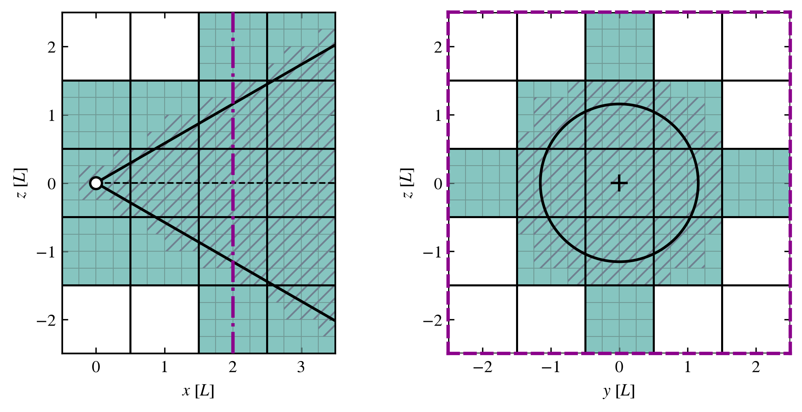

Building lightcones
===================

.. currentmodule:: swiftlet.snapshot_lightcone

A lightcone is built from the snapshots of a simulation with :class:`SnapshotAllSky` (the whole sky) or
:class:`SnapshotBeam` (a pencil beam). Both are filled with copies of the snapshot box, re-oriented and placed on a
lattice around the observer (see :doc:`orientation`). 
This page covers the choices that need to be made in this process, first at a surface level and then in a more detailed 
:ref:`step-by-step walkthrough <lightcone-step-by-step>`. 

.. important::
   **Lightcones should be built in thin redshift shells.**
   The comoving volume of a lightcone quickly grows larger than that of a snapshot. For example, with the COLIBRE
   ``L400_m7`` simulations, an all-sky lightcone for redshifts :math:`z=0 - 0.2` (a comoving radius of :math:`\approx 838`
   Mpc) holds the comoving volume, and the disk space, of :math:`\approx 39` snapshots.

Defining a lightcone
--------------------

A lightcone needs:

*   **the simulation**: a :class:`Simulation <swiftlet.simulation_suites.Simulation>`, passed as
    ``simulation_object``, or its ``boxsize_resolution`` and ``simulation_name`` given by keyword (see
    :doc:`new_simulations_and_suites`)
*   **its geometry**: :class:`SnapshotAllSky`, a spherical lightcone or :class:`SnapshotBeam`, a cone with a direction,
    (the angular radius is given when the beam is filled)
*   **the orientation of its tiles**: the ``orientation_table`` (the default table if not given), the
    ``orientation_lock`` (``None``, ``"cube"`` or ``"sphere"``) and the ``orientation_seed`` (see :doc:`orientation`
    and :doc:`orientation_tables`).

.. code-block:: python

    from swiftlet import Simulation, SnapshotAllSky, SnapshotBeam

    sim = Simulation.from_label("L0400N3008", "Thermal")   # COLIBRE L400_m7, Thermal AGN

    all_sky = SnapshotAllSky(simulation_object=sim, orientation_lock="cube", orientation_seed=0)
    beam = SnapshotBeam(simulation_object=sim, beam_vector=(1, 2, 3), orientation_lock="cube", orientation_seed=0)

With the same tables, lock and seed, ``beam`` is exactly the subvolume of ``all_sky`` inside its cone (see
:ref:`beams-are-part-of-the-all-sky-lightcone`).

.. tip::
   Before building a large lightcone it is a good idea to check how close periodic replicas will be within the lightcone.
   This can be done using the cell structure along with :func:`find_close_cell_repeats <swiftlet.repeat_check.find_close_cell_repeats>` 
   (see :doc:`repeated_objects`).

Populating a lightcone
----------------------

A lightcone is populated one redshift shell at a time, with particles or haloes, in two steps:

#.  **Gather**: find the snapshots that fill the shell, the tiles each one is placed in, and the cells (and so the
    files) to read, from the cell metadata of the snapshots only. No particle data is read.
#.  **Read and place**: read the particles (or haloes) of those cells, move them into each tile, and keep those inside
    the shell (and the beam).

The diagram below sketches out what the end result of the gather step looks like for a lightcone beam. 

.. _fig-cell_selection:

   The tiles added to the lattice and the cells that the lightcone passes through are shaded and hatched, respectively. 
   Left: The xz plane, showing the line along the beam. Right: The zy plane, showing the cross section of the beam 
   indicated by the magenta line on the left panel. 

The methods that do both steps at once are:

.. list-table::
   :header-rows: 1
   :widths: 40 60

   * - Method
     - Places

   * - :meth:`SnapshotLightcone.place_snapshot_particles_in_shell`
     - the particles of one or more particle types, with the properties asked for (``Coordinates``,
       ``ExpansionFactors``, ``SnapshotNumber`` and ``ParticleIDs`` always, and ``SmoothingLengths`` for every type
       but dark matter, ``PartType1``). ``Velocities``, if asked for, are re-oriented with the coordinates

   * - :meth:`SnapshotLightcone.place_halos_in_shell`
     - the haloes of the SOAP catalogues, at the paths of the simulation's ``soap_format`` (see
       :ref:`soap-halo-catalogues`), with the properties needed to find each halo in its catalogue (see
       :doc:`halo_lightcones`)

Both methods can work with MPI to share the work between ranks (see :doc:`parallel_and_hpc`).

A simulation's snapshot can be missing on disk: the snapshots next to it then fill its redshifts, with a 
:class:`SnapshotGapWarning`, as long as the snapshots filling a shell are less than 0.1 apart in redshift.

.. caution::
    The limit can be changed with :envvar:`SWIFTLET_MAX_SNAPSHOT_SPACING` (see :ref:`max-snapshot-spacing`), but 
    raising it gives larger discontinuities between snapshots, and above 0.25 the steps in time between them are too 
    large.

.. _placing-files-one-at-a-time:

Placing files one at a time
^^^^^^^^^^^^^^^^^^^^^^^^^^^

A large shell can hold more particles than fit in memory. :meth:`SnapshotLightcone.gather_files` runs the gather step
alone, for one particle type, and returns every (snapshot, tile, file) piece to read. 
:meth:`SnapshotLightcone.place_file_in_shell` then reads and places one piece at a time, so each can be added to a map
and discarded:

.. code-block:: python

    nr_pieces, pieces = beam.gather_files("PartType1", (0.1, 0.2), ang_radius_deg=2.)
    for piece in range(nr_pieces):
        particles = beam.place_file_in_shell(piece, "PartType1", ["Masses"], ang_radius_deg=2.)
        if len(particles):
            ...  # add particles["Coordinates"] and particles["Masses"] to a map

The particles placed this way are the same as those of
:meth:`place_snapshot_particles_in_shell <SnapshotLightcone.place_snapshot_particles_in_shell>` for the same shell.

.. _lightcone-output:

What is returned
----------------

Each method returns a :class:`LightconeOutput`: a dictionary of `unyt` arrays, one row per particle or halo (for
particles, one :class:`LightconeOutput` per particle type), with the positions relative to the observer. Its
``.metadata`` records every setting that made it:

*   the lightcone type, the simulation (suite, label and name)
*   the ``orientation_seed``, ``orientation_lock``, the ``orientation_table`` and the fingerprint of its contents
*   the beam vector and angular radius, and the redshift range

Given the same settings and snapshots, the same lightcone is made again (see :doc:`orientation_tables`).
:func:`write_lightcone_metadata` and :func:`read_lightcone_metadata` write and read the metadata in HDF5 files, and
:func:`write_halo_lightcone_file` writes a halo lightcone in the format of the LightconeIO halo lightcones (see the
:doc:`../quickstart`).

.. _lightcone-step-by-step:

Building lightcones: Step by step
---------------------------------

What happens when a lightcone is set up and filled with particles or haloes, step by step.

Placing particles
^^^^^^^^^^^^^^^^^
 
.. dropdown:: Flowchart: placing particles into a lightcone
   :icon: workflow
   :animate: fade-in

   .. mermaid:: mermaid/snapshot_lightcone_particles.mmd
      :align: center
      :caption: Placing particles: choosing the snapshots, gathering the pieces to read, and reading and placing them.

:meth:`SnapshotLightcone.place_snapshot_particles_in_shell` places every particle type asked for; or
:meth:`SnapshotLightcone.gather_files` and :meth:`SnapshotLightcone.place_file_in_shell` place one particle type, one
file at a time. For each particle type:

**Choosing the snapshots**

#.  The snapshots filling the shell are chosen from their output redshifts, unless given with ``use_snapshots``. Each
    snapshot fills the redshifts between the midpoints to its neighbours.
#.  Snapshots missing on disk (their file 0) are filled by the available snapshots, each nearest in redshift to its
    own, with a :class:`SnapshotGapWarning` (see :ref:`max-snapshot-spacing`).

**Step 1, gather** (no particle data is read)

#.  For each snapshot, its redshift range is clipped to the lightcone, and its cell metadata (cell centres, and which files
    hold the particle type) is loaded.
#.  The tiles the lightcone passes through are found. With ``"sphere"``, the tiles crossing a layer sphere are
    split into one :term:`piece` (tile, snapshot) per layer, each with its own redshift range.
#.  For each tile, its orientation is read from the tables, from its position on the lattice (or its layer) and the
    seed. The periodic cell shift, reflections and quarter turns are applied on each axis. 
#.  The cell centres are transformed and moved to the tile's position, and the cells inside the tile's part of the
    lightcone are kept (with a buffer of one cell length).
#.  A :class:`FileReadSpec` (snapshot, tile, file, offsets and lengths of the cells) is recorded for 
    each file with particles in those cells. A file needed by several tiles is read once for each tile, with 
    ``"sphere"``, a tile crossing a sphere is read once for each layer.

:meth:`gather_files <SnapshotLightcone.gather_files>` stops here, and returns the 
:class:`FileReadSpec`\ s for :meth:`place_file_in_shell <SnapshotLightcone.place_file_in_shell>` to 
place one at a time.

**Step 2, read and place**

#.  The :class:`FileReadSpec`\ s are read on one process, or shared in blocks between the MPI ranks 
    if ``comm`` is given.
#.  For each one, only the particles of its cells are read: ``Coordinates``, ``ParticleIDs``, ``SmoothingLengths``
    (except for dark matter) and the properties asked for.
#.  The tile's transform is applied to the coordinates. ``Velocities``, if read, take the tile's reflection and
    rotation (not its periodic shift or position, which move positions but not directions), so each velocity keeps
    its direction relative to its particle's surroundings.
#.  The particles exactly inside the tile's part of the lightcone (and the beam) are kept, with their 
    ``SnapshotNumber``.
#.  The kept particles are joined and their ``ExpansionFactors`` are computed from their comoving distance to the 
    observer.
#.  With MPI and ``redistribute_halos=True``, the particles are shared evenly between the ranks.

The result is a :class:`LightconeOutput` ``{particle type: data}``, with the lightcone's ``.metadata``.

Placing haloes
^^^^^^^^^^^^^^

.. dropdown:: Flowchart: placing haloes into a lightcone
   :icon: workflow
   :animate: fade-in

   .. mermaid:: mermaid/snapshot_lightcone_haloes.mmd
      :align: center
      :caption:  Placing haloes from the SOAP catalogues.

:meth:`SnapshotLightcone.place_halos_in_shell` (with :meth:`SnapshotLightcone.gather_halo_catalogues` for its gather
step) places the haloes of the SOAP catalogues exactly as particles are placed (See :doc:`halo_lightcones` for further 
applications and examples). 

**Step 1, gather**

#.  The snapshots are chosen as for particles, from the SOAP catalogues on disk (gaps filled with a warning, and a
    ``ValueError`` if they are 0.1 or more apart in redshift; see :ref:`max-snapshot-spacing`).
#.  The cell metadata are read from one snapshot only (it is the same in every snapshot).
#.  For each snapshot, its redshift range is clipped to the lightcone, and the tiles (and spherical layers) the 
    lightcone are found.
#.  A :class:`HaloCatalogueSpec` (snapshot, tile, catalogue and redshift range) is 
    recorded for each tile, with the catalogue's number of haloes. If the gather step has already been run with the same 
    arguments, it is not repeated.

**Step 2, read and place**

#.  The catalogues are split into pieces of ``soap_chunk_size`` rows, read on one process or shared between the MPI
    ranks.
#.  For each piece, the halo centres and catalogue indices of its rows are read once.
#.  For each tile of its snapshot, the tile's transform is applied to the halo centres, as for particles, and the haloes
    exactly inside the tile's part of the shell are kept, with their snapshot, ``HaloCatalogueIndex`` and
    ``SOAPIndex`` (row in the catalogue).
#.  With MPI and ``redistribute_halos=True``, the haloes are shared evenly between the ranks.
#.  Each halo is assigned a ``Lightcone/ExpansionFactor`` based on its comoving distance from the observer. 

Unlike particles, each SOAP catalogue is read once, and its haloes placed in every tile where it fills the snapshot's
redshift range. SOAP catalogues are not sorted by cell, so every halo is tested. The result, a :class:`LightconeOutput`
with ``Lightcone/HaloCentre``, ``Lightcone/ExpansionFactor``, ``Lightcone/SnapshotNumber``,
``InputHalos/HaloCatalogueIndex`` and ``InputHalos/SOAPIndex``, maps each halo back to its SOAP catalogue and all its
properties, via ``Lightcone/SnapshotNumber`` and ``InputHalos/SOAPIndex`` (see :doc:`halo_lightcones`). 

