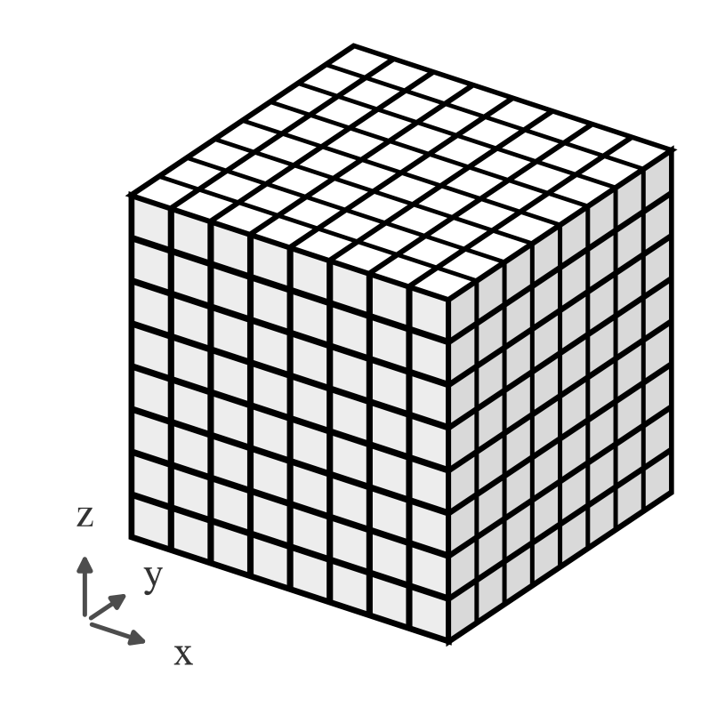
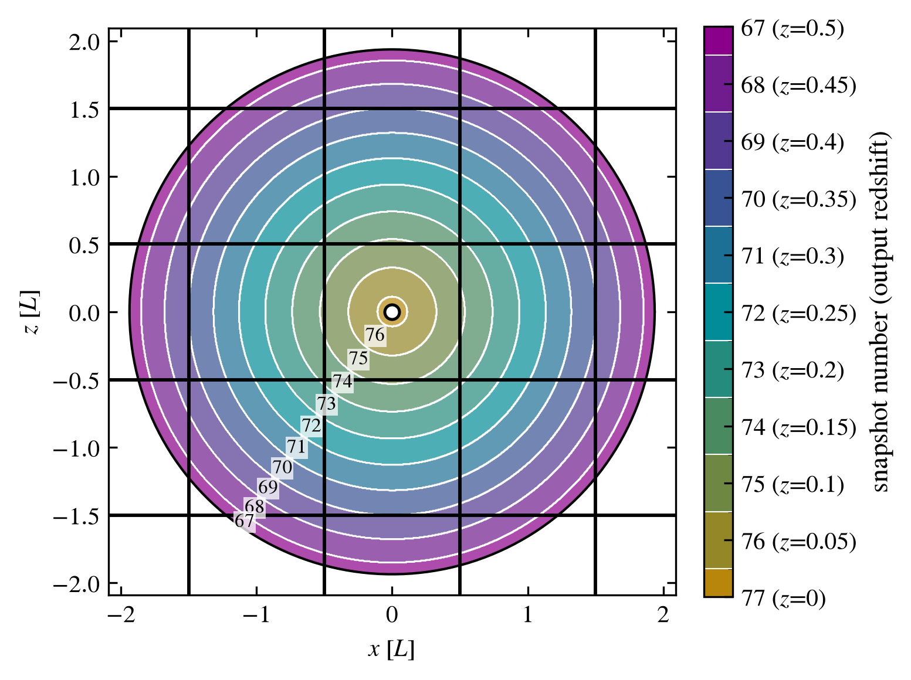
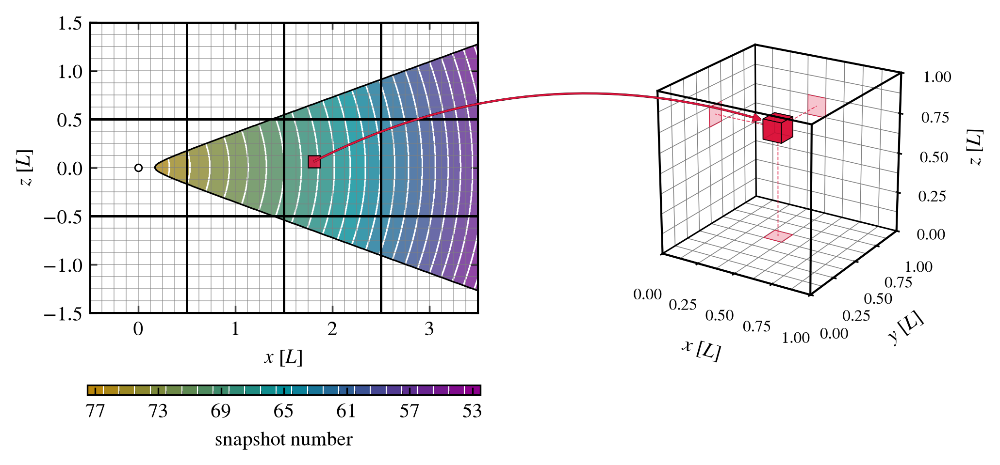
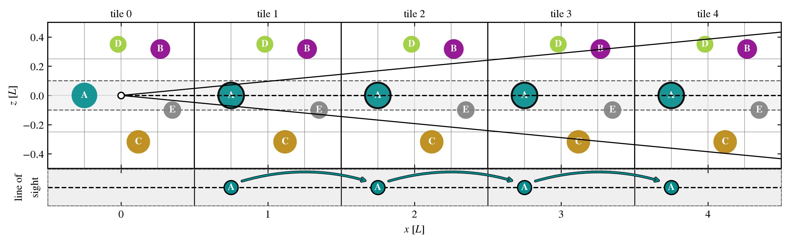
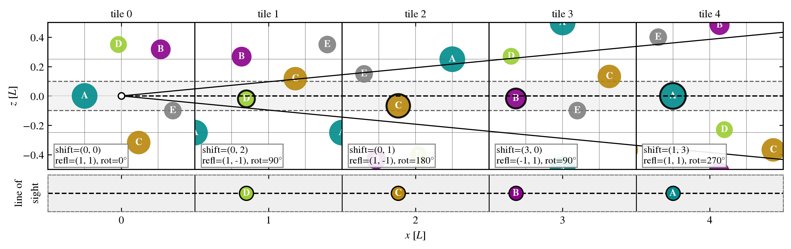

Overview
========

.. currentmodule:: swiftlet.snapshot_lightcone

This page gives an overview of the key ideas related to how SWIFTLET builds a lightcone from the snapshots of a `SWIFT <https://swift.strw.leidenuniv.nl/docs/index.html>`_
simulation and summarises the main steps involved in this process, with links to the corresponding pages for further 
information. 

.. _fig-tile-cells-cube:

   
   Diagram of a tile in the lightcone: a SWIFT simulation's comoving volume and top level cell structure

Not all cosmological simulations build lightcones on-the-fly, instead the typical data products are snapshots of the 
simulation at discrete time intervals. The main functionality of :mod:`swiftlet` is to provide an easy to use, 
post-processing, pipeline that slices snapshots together into lightcones (and halo lightcones). 
Note this is not meant to replace lightcones that are built on-the-fly, instead :mod:`swiftlet` should be used in their 
absence or as a supplementary tool to increase the number of realisations. 

Linking snapshots and lightcones
^^^^^^^^^^^^^^^^^^^^^^^^^^^^^^^^

:mod:`swiftlet` builds lightcones from the snapshots of SWIFT simulations at the :term:`cell` level by slicing and periodically 
replicating snapshots (see `cell structure of SWIFT simulations <https://swift.strw.leidenuniv.nl/docs/Snapshots/index.html>`_ 
). In essence this boils down to overlaying concentric sphereical shells, centred on the observer, on to a regular 3D
lattice of tiles. Each :term:`tile` is an copy of the simulations box, with the same comoving sidelength and cell 
structure (see the :ref:`tile structure diagram <fig-tile-cells-cube>`). 

.. _fig-shells-fullsky:

   The redshift shells and corresponding snapshot numbers for the fiducial L1_m9 FLAMINGO simulation. The regular
   lattice of tiles is overlaid, where each tile has side length :math:`L`.

The boundaries (the inner and outer radii) of each concentric shell are defined in redshift and given by the midpoints 
between the output redshifts of neighbouring snapshots (see :ref:`redshift shell diagram <fig-shells-fullsky>`). 
The redshift of any point in the lightcone is computed from its comoving distance to the observer. 

As the lightcone grows the lattice is extended, by adding new tiles,  so that it envelops the whole lightcone. 
For an all-sky (spherical) lightcone this means growing the lattice in all directions, however if the lightcone is a 
beam (a cone) then the lattice extends only in the direction of the beam.  

The lightcone is then populated, at the cell level, with particles from the snapshots  To do this the snapshots redshift 
shells are placed compared against the lattice and then the cells from the lattice are mapped to the snapshots in the 
concentric shells. Where for every cell, in each tile, that the lightcone passes through the particles are read from the
exact same cell in the corresponding snapshot. This mapping between the lattice and snapshots is demonstrated for a 
lightcone beam in the :ref:`figure below <fig-cell-in-shell>`. Only the particle data within the flagged cells is read 
from the snapshots. 

.. _fig-cell-in-shell:

   Left: A slice of the lattice of tiles and cells that contain the lightcone beam, with the snapshot redshift shells 
   overlaid, with a random cell selected. 
   Right: The comoving volume and top-level cell structure of snapshot 68 with the same select cell from the lightcone 
   highlighted. The particle data (or haloes) in this cell would be added to the lightcone. 

See :doc:`building_lightcones` to read further on building a lightcone and :doc:`halo_lightcones` for building 
lightcones from the halo catalogues. 

Periodic replications
^^^^^^^^^^^^^^^^^^^^^

A core part of building lightcones with the snapshot slicing method is extending the lattice of tiles in the direction 
of the lightcone. However, as each tile is a replica of the snapshots box, for every box sidelength :math:`L` travelled 
along the lightcone, the structure within that snapshots box will be periodically replicated along that same line of 
sight.Therefore, after the lightcone reaches a radius of :math:`n` sidelengths, the same structures will then appear 
:math:`n` times in set periodic intervals as shown in the diagram :ref:`below <fig-periodic_replica-0>`. This kind of 
periodic replication heavily biases any measurements made from the generated lightcones (e.g. clustering statistics). 

.. _fig-periodic_replica-0:

   The periodic replication of structures along the line of sight for lightcone beam that extends past the sidelength of 
   a snapshot multiple times. 

Tile orientation
^^^^^^^^^^^^^^^^

The most straight forward method prevent the exact periodic replication of each snapshot box is to introduce some simple 
isometeric transformations on each tile in the lattice to change their orientation. 
Within :mod:`swiftlet` this is controlled via :term:`tables <orientation table>` (see :doc:`orientation_tables`) with 
predetermined instructions on how to: 

#.  periodically shift the cells in the tiles along each axis
#.  reflect the tile along each axis 
#.  rotate the tile by quarter turns about each axis

By re-orienting the tiles (treating them as rubics cubes) new realisations of the same simulations can be 
easily generated. However, by doing this we are introducing discontinuties into the lightcone as where tiles of 
different orientations meet the transition between them is no longer continuous. 

.. Note::
    That depending on the circumstances of building the lightcone it can be best to not generate these discontinuities 
    and instead keep all tiles with the same orientation.

The order that these :term:`orientation tables <orientation table>` are read and where the discontinuties occur are controlled by an 
:term:`orientation seed` and :term:`orientation lock`. specifically the locks are used to control where the 
discontinuities occur by organising the lightcones into layers of tiles that share the same orientation and therefore 
form one continuous layer with no discontinuities inside of it. See :doc:`orientation` for further information on the 
tile orientatios and building these layers. 

.. _fig-periodic_replica-1:

   The same lightcone as given in the :ref:`previous figure <fig-periodic_replica-0>`, except the cells in each tile 
   have either been periodically shifted, reflected or rotated by a quarter turn about each axis. The same structures are 
   no longer repeated along the same line of sight. 

Another consequence of from altering the orientation of the tiles is that two copies of the same region in 
adjacent tiles will end up close together than exactly one sidelength of the snapshot box. Again, in most cases how close
periodic replicas of the cells in adjacent tiles can be to one another is controlled by the :term:`orientation table`, 
and can be checked within :mod:`swiftlet` as described in :doc:`repeated_objects`. 

