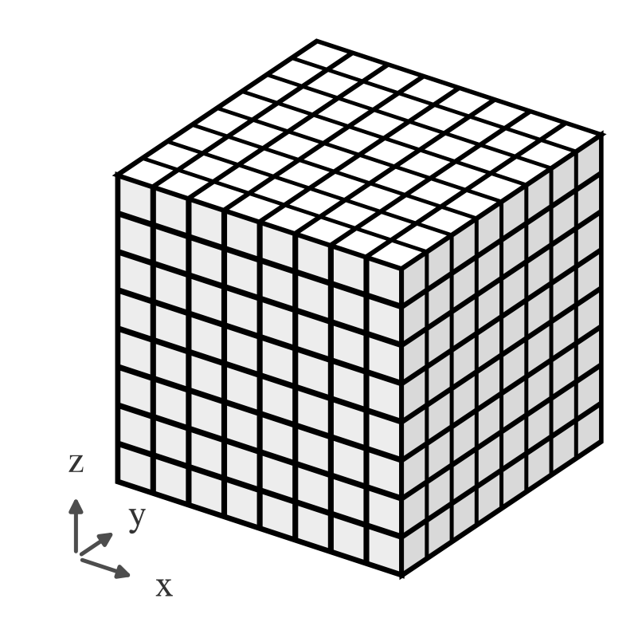
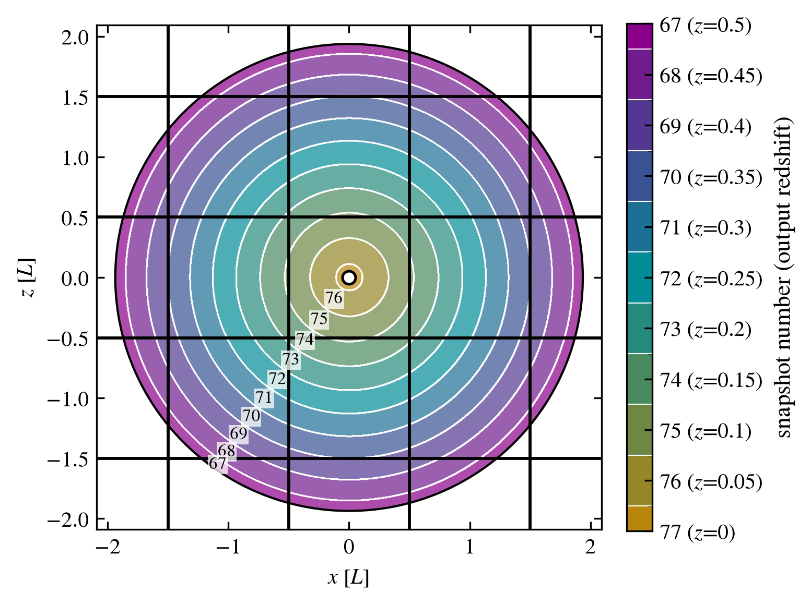
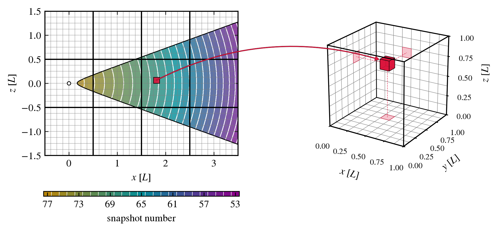
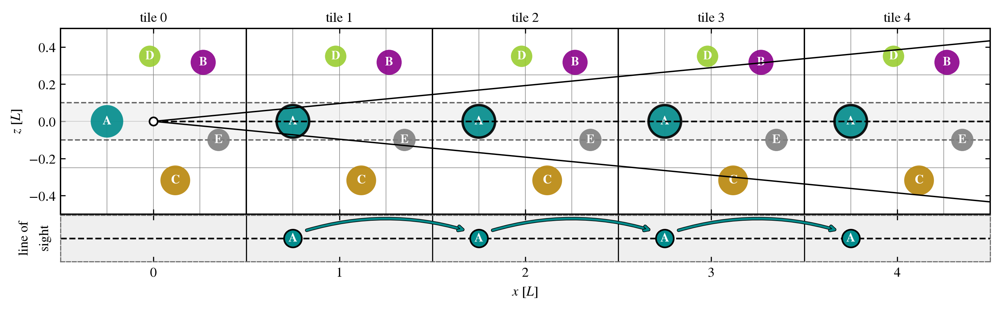
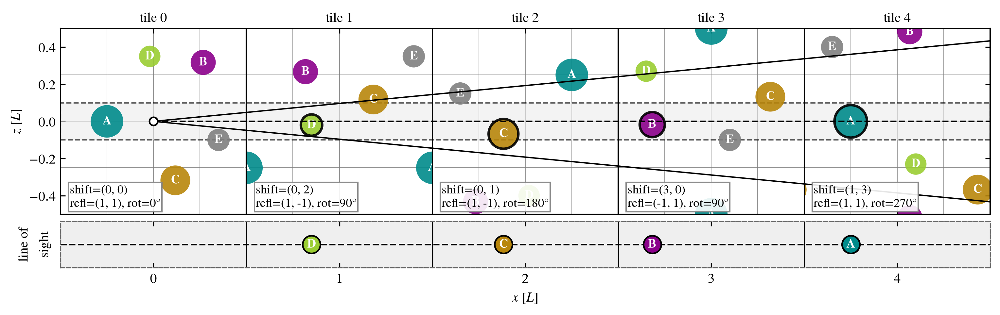

Main Ideas
==========

.. currentmodule:: swiftlet.snapshot_lightcone

The main functionality of :mod:`swiftlet` is to provide an easy to use post-processing pipeline for building lightcones 
from the snapshots and halo catalogues of `SWIFT <https://swift.strw.leidenuniv.nl/docs/index.html>`_ cosmological 
simulations. 
This page provides as overview of the key concepts behind building lightcones with :mod:`swiftlet` and serves as an 
introduction to this tool kit. 

.. _fig-tile-cells-cube:

   
   Diagram of a :term:`tile` in the lightcone: a SWIFT simulation's comoving volume and top level cell structure

.. Note::
   Lightcones built with :mod:`swiftlet` are not meant to replace FLAMINGOs pre-exising lightcones that where built 
   on-the-fly. Instead :mod:`swiftlet` is best used to complement the on-the-fly lightcones by: generating new 
   realisations of the same lightcones (adding lightcones for new observers), resampling specific sub-volumes of the 
   lightcones or extending FLAMINGOs particle lightcones to higher redshifts. 

Linking snapshots and lightcones
--------------------------------

:mod:`swiftlet` builds lightcones from the snapshots of SWIFT simulations at the :term:`cell` level by slicing and 
periodically replicating snapshots (see `cell structure of SWIFT simulations <https://swift.strw.leidenuniv.nl/docs/Snapshots/index.html>`_ 
). In essence this comes down to placing concentric sphereical shells, centred on the observer, on top of a regular 3D
lattice of square tiles, where the intersection of these two grids to indicates the exact redshifts and snapshot 
sub-volumes to copy into the lightcone. Each :term:`tile` is a copy of the simulations box, with the same 
comoving sidelength and cell structure (see the :ref:`tile structure diagram <fig-tile-cells-cube>`). 

.. _fig-shells-fullsky:

   The redshift shells and corresponding snapshot numbers for the fiducial L1_m9 FLAMINGO simulation. The regular
   lattice of tiles is overlaid, where each tile has side length :math:`L`.

The boundaries (the inner and outer radii) of each concentric shell are defined in redshift and given by the midpoints 
between the output redshifts of neighbouring snapshots (see :ref:`redshift shell diagram <fig-shells-fullsky>`). Simply, 
the thickness of each shell is given by each :term:`snapshots redshift range <snapshot redshift range>`. 
The redshift of any point in the lightcone is computed from its comoving distance to the observer. 

As the lightcone grows the lattice is extended, by adding new tiles, so that the lightcone always remains within the 
lattice. For an :term:`all-sky lightcone` (spherical) this means growing the lattice in all 
directions, however if the lightcone is a :term:`beam` (or a cone) then the lattice extends only in the direction of the 
beam.  

The lightcone is then populated tile by tile and cell by cell with particles and haloes from the snapshots. For every 
cell in the lattice that the lightcone passes through, we identify the snapshot whose 
:term:`redshift range <snapshot redshift range>` covers the chosen cell, and the particles (and haloes)  of 
the same cell in that snapshot are read as shown in the :ref:`figure <fig-cell-in-shell>` below. 

.. _fig-cell-in-shell:

   Left: A slice (along the y-axis, showing the xz plane) of the lattice of tiles (black lines, side length of 
   :math:`L`) and cells (thin grey lines) that contain a lightcone beam with the snapshot redshift shells are overlaid. 
   A random cell (in snapshot 68) has been selected and highlighted in red. 
   Right: The comoving volume and top-level cell structure of snapshot 68 with the same random cell from the lightcone 
   highlighted. The particle data (or haloes) in this cell would be added to the highlighted cell in the lightcone. 

See :doc:`building_lightcones` to read further on building a lightcone and :doc:`halo_lightcones` for building 
lightcones from the halo catalogues. 

Periodic replications
---------------------

As the lightcone extends to higher redshifts the lattice must also be extended in the same directions. As each tile is a 
replica of the snapshots box, for every box sidelength :math:`L` travelled 
along the lightcone, the structures within that snapshots will be periodically replicated along that same line of 
sight. Meaning, for every :math:`n` sidelengths along the lightcone, the same structures will then appear 
:math:`n` times, in set periodic intervals (:math:`L` Mpc apart) as shown in the 
:ref:`diagram <fig-periodic_replica-0>` below. This kind of :term:`exact periodic replication <exact periodic replica>` 
can heavily bias measurements made from the lightcones (e.g. clustering statistics). 

.. _fig-periodic_replica-0:

   The periodic replication of structures along the line of sight for a lightcone beam that extends past the sidelength 
   (:math:`L`) of a snapshot multiple times. 

Tile orientation
----------------

The The simplest way to prevent the exact periodic replication of each snapshot box is to use isometeric transformations 
on each tile in the lattice to change their :term:`orientation`. Within :mod:`swiftlet` this is controlled via 
:term:`tables <orientation table>` (see :doc:`orientation_tables`) which have predetermined instructions on how to: 

#.  periodically :term:`shift the cells <cell shift>` in the tiles along each axis
#.  reflect the cells in a tile along each axis 
#.  rotate the cells in a tile by quarter turns about each axis

Re-orienting the tiles and its cells (e.g., treating each tile as a Rubik's cube) gives new realisations of the same 
simulations. However, by doing this we are introducing discontinuities into the lightcone, as 
where tiles of different orientations meet they no longer share the same periodic boundary and therefore the transition 
between them is no longer continuous. 

.. Note::
    Depending on the situation and intended use of the lightcone it can be best to not alter the orientation of the 
    tiles and therefore avoid these discontinuities all together.

The order that these :term:`orientation tables <orientation table>` are read and where the discontinuities occur are 
controlled by an :term:`orientation seed` and :term:`orientation lock`, respectively. The seeds do not alter the 
orientation, only the order that the instructions from the table are read. 
The locks are used to control where the discontinuities occur by organising the lattice of tiles into 
:term:`layers <layer>` that share the same orientation. Meaning that discontinuities only occur at the boundaries of 
these layers. See :doc:`orientation` for further information on the tile orientations and building these layers. 

.. _fig-periodic_replica-1:

   The same lightcone as given in the :ref:`previous figure <fig-periodic_replica-0>`, except the cells in each tile 
   have either been periodically shifted, reflected or rotated by a quarter turn about each axis. The same structures 
   are no longer repeated along the same line of sight. 

Another consequence of altering the orientation of the tiles is that two copies of the same cell in 
adjacent tiles will end up closer together than exactly one sidelength of the snapshot box. In most cases it is possible 
to control the minimum distance between periodic replicas of the same cell with the :term:`orientation table`, which can 
be checked within :mod:`swiftlet` as described in :doc:`repeated_objects`. 

