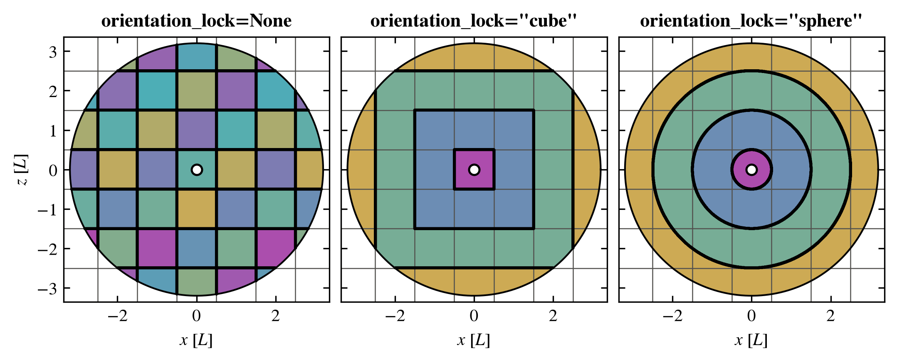

Lightcone geometry and tile orientation
=======================================

.. currentmodule:: swiftlet.snapshot_lightcone

A lightcone built from snapshots is filled with copies of the snapshot box, called :term:`**tiles** <tile>`, laid on a 
regular lattice around the observer. Each tile is a re-oriented copy of the box, so the same structures don't simply 
repeat every box length. This page explains where the tiles are, which snapshot fills which part of each tile, and how 
the tiles are oriented with the ``orientation_lock`` and ``orientation_seed``.

The lattice of tiles
--------------------

The observer sits at the centre of the first tile, ``(0, 0, 0)``. The tile ``(nx, ny, nz)`` is the copy of the box
whose centre is :math:`(n_x, n_y, n_z)\,L` from the observer, for a box of side length :math:`L`, so the tiles fill
space exactly once, with no gaps or overlaps.

Each snapshot covers a range redshifts in the lightcones based on the redshifts between the midpoints to its
neighbouring snapshots (see :doc:`new_simulations_and_suites`). A snapshots data is placed in every tile whose comving
distance from the observer overlaps with the snapshots redshift range, and in each tile only the part within that range 
(and within the beam, for a :class:`SnapshotBeam`) is kept. So a tile can span across several snapshots, each in its 
own shell, and one snapshot can pass through many tiles (see :ref:`example diagram <fig-cell-in-shell>`.)

Within a tile, the snapshot's cells are first moved as the tile's orientation says (a periodic shift, a reflection and a
rotation, see :doc:`orientation_tables`), and then placed at the tile's position.

Orientation of the tiles
------------------------

Each tile's orientation is one row of the orientation tables, chosen from the tile's position on the lattice and the
``orientation_seed`` (see :ref:`how a tile picks its row <orientation-row>`). The ``orientation_lock`` sets which tiles
share an orientation:

.. list-table::
   :header-rows: 1
   :widths: 15 40 45

   * - ``orientation_lock``
     - Tiles sharing one orientation
     - Where the orientation changes

   * - ``None``
     - none: every tile has its own
     - at every face between tiles

   * - ``"cube"``
     - every tile in a cubic layer of tiles around the observer's tile, :math:`\max(|n_x|, |n_y|, |n_z|) = n`
     - on the faces between the cubic layers

   * - ``"sphere"``
     - everything in a spherical layer, between :math:`(n - \frac{1}{2})L` and :math:`(n + \frac{1}{2})L` from the
       observer
     - on the spheres between the layers, which pass through the tiles

Within a layer of ``"cube"`` or ``"sphere"``, the tiles are repeated periodically, so the layer is continuous, meaning 
there are no discontinuities within the tiles of the layers. With ``"sphere"``, a tile crossing a sphere between two 
layers is used once for each layer, each piece taking its own layer's orientation and filling only its own layer's 
distances; its tiles are labelled ``(nx, ny, nz, layer)``.

The choice of lock changes where copies of the same objects lie, not how many there are. It decides where they can
be in contact or be close along a line of sight (see :doc:`repeated_objects`):

*   ``None``: the most variety, as every tile is oriented differently, but every tile face is a change of orientation
*   ``"cube"``: structures are only cut, and can only repeat closely, on the faces between layers
*   ``"sphere"``: the orientation only changes at fixed distances from the observer, but those spheres pass through the
    tiles, resulting in clashes where copies of the same cell are in contact. 

.. _fig-layers-example:

   
   A slice showing the xz plane of an all-sky lightcone for each of the different orientation locks. Different tile
   orientations are indicated by colour of the tiles.

A beam narrower than the box crosses few tiles, so the lock does not really matter in this instance. For all-sky 
lightcones and wide beams (with a diameter greater than a boxes sidelength), compare the locks and seeds with 
:func:`find_close_cell_repeats <swiftlet.repeat_check.find_close_cell_repeats>` before building the lightcone 
(see :ref:`checking-a-lightcone-for-close-repeats-before-building-it`).

The ``orientation_seed`` changes which row each tile (or layer) takes, so different seeds give different realisations 
of the same simulation. The same seed, lock, tables and snapshots always returns the same lightcone.

.. warning::
    ``orientation_lock="sphere"`` is more computationally expensive than ``"cube"``, as the tiles interceptd by the 
    sphereical layers are operated on twice, and the same region of a snapshot can appear in both shells, 
    at different positions and orientations.

.. _beams-are-part-of-the-all-sky-lightcone:

Beams and all-sky lightcones
----------------------------

:class:`SnapshotAllSky` labels each tile with its position on the lattice, ``(nx, ny, nz)``. :class:`SnapshotBeam`
labels its tiles in its own frame, ``(nx, ny, n_los)``: ``n_los`` counts tiles along the lattice axis closest to the
beam's direction, and ``nx`` and ``ny`` along the two axes closest to the directions across the beam. The beam's frame
is a signed permutation of the lattice's axes, so each label is one lattice position.

The orientation of a tile is always read from its **position on the lattice**, converted back from the beam's label, and
the tile is placed at that position. So a tile takes the same orientation in a beam, whatever its direction, as in the
all-sky lightcone. So beams pointing in different directions are pieces of the one larger all-sky lightcone. 

.. important::

    **A beam is exactly the part of the all-sky lightcone that lies inside its cone**, with the same orientation
    tables, ``orientation_lock`` and ``orientation_seed``: the same particles and haloes, from the same snapshots, at
    the same positions, for every lock and none.

