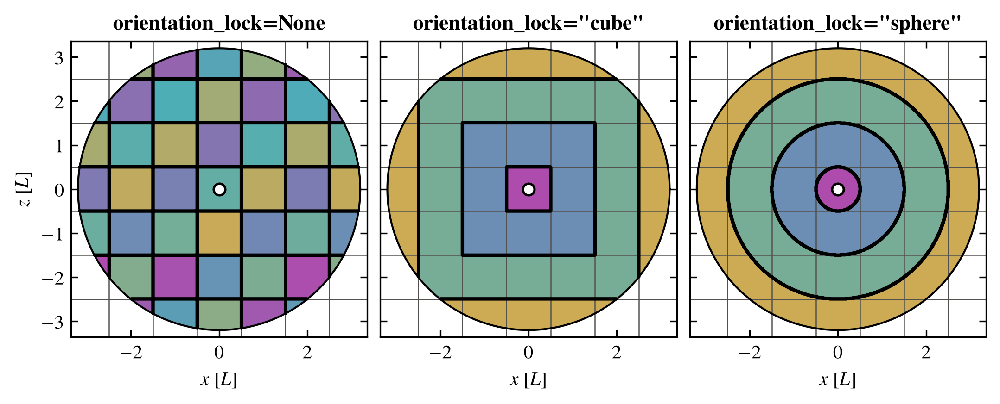

Lightcone geometry and tile orientation
=======================================

.. currentmodule:: swiftlet.snapshot_lightcone

The lattice of tiles
--------------------

The observer sits at the centre of the first :term:`tile`, ``(0, 0, 0)``. The tile ``(nx, ny, nz)`` is the copy of the 
box whose centre is :math:`(n_x, n_y, n_z)\,L` from the observer, for a box of side length :math:`L`, so the tiles fill
space exactly once, with no gaps or overlaps.
Within the first tile, as the :term:`observers position <observer position>` is in the centre of the tile, it is always 
a point where the corners of cells meet and never at a cell centre given there are an even number of cells per axis 
for all current COLIBRE and FLAMINGO simulations. By default the observer or centre of the lattice corresponds to 
:math:`(L/2, L/2, L/2)` in the snapshots box, the observers location in the snapshots box can be changed; see 
:ref:`observer-position`.

In the lightcone each snapshot covers the range of redshifts given by the the midpoints to its neighbouring snapshots 
(see :doc:`new_simulations_and_suites`). A snapshots data is placed in every tile whose comoving
distance from the observer overlaps with the :term:`snapshots redshift range <snapshot redshift range>`, and in each 
tile only the part within that range (and within the :term:`beam`, for :class:`SnapshotBeam` and 
:class:`SnapshotSquareBeam`) is kept. So a tile can span across several snapshots, each in its own shell, and one 
snapshot can pass through many tiles (see :ref:`example diagram <fig-cell-in-shell>`).

Within a tile, the snapshot's :term:`cells <cell>` are first moved as the tile's orientation says (a 
:term:`periodic shift <cell shift>`, a reflection and a rotation, see :doc:`orientation_tables`), and then placed at the 
tile's position.

.. _beams-are-part-of-the-all-sky-lightcone:

Beams and all-sky lightcones
----------------------------

:class:`SnapshotAllSky` labels each tile with its :term:`position <lattice position>` on the lattice, ``(nx, ny, nz)``. 
:class:`SnapshotBeam` labels its tiles in its own frame, ``(nx, ny, n_los)``: ``n_los`` counts tiles along the lattice 
axis closest to the beam's direction, and ``nx`` and ``ny`` along the two axes closest to the directions across the 
beam. The beam's frame is a signed permutation of the lattice's axes, so each label is one lattice position.

The orientation of a tile is always read from its **position on the lattice**, converted back from the beam's label, and
the tile is placed at that position. So a tile takes the same orientation in a beam, whatever its direction, as in the
all-sky lightcone. Beams pointing in different directions are pieces of the one larger all-sky lightcone. 

.. important::

    **A beam is an exact subvolume of the all-sky lightcone that it sits inside.** The cone or square pyramid of the 
    beam returns the same lightcone (the same particles and haloes) as for that subvolume within an all-sky lightcone 
    for the same orientation tables, ``orientation_lock`` and ``orientation_seed``.

.. _circular-and-square-beams:

Circular and square beams
-------------------------

A beam can be circular on the sky, a :class:`SnapshotBeam`, or square, a :class:`SnapshotSquareBeam`
(see :ref:`square-beams` for how to make one). 

As both are subclasses of :class:`SnapshotLightcone` they share **the same pipeline** for gathering, reading and placing 
particles or haloes into a lightcone. Moreover both of the beam building classes **label their tiles in the same frame**
, ``(nx, ny, n_los)``, and have the ``orientation_lock``, ``orientation_seed`` and :term:`observer position`. So both 
are exactly the part of the all-sky lightcone inside their footprint 
(see :ref:`beams-are-part-of-the-all-sky-lightcone`), and a square beam is also exactly the part of the circular beam 
through its corners that lies inside the square.

**How they are different**

.. list-table::
   :header-rows: 1
   :widths: 22 39 39

   * -
     - Circular beam, :class:`SnapshotBeam`
     - Square beam, :class:`SnapshotSquareBeam`
   * - Shape
     - a cone: every direction within ``ang_radius_deg`` of the axis
     - a square pyramid: four flat faces, each half the side length from the axis
   * - Set by
     - ``ang_radius_deg``, the angle from the axis to the edge
     - ``ang_side_length_deg``, the angle between opposite sides of the square, measured through the axis
   * - Edge on the sky
     - a small circle, the same distance from the axis all round
     - four arcs; the corners are further from the axis than the middle of the sides
   * - Across the beam
     - a circle at every distance
     - a true square in the plane perpendicular to the axis at every distance
   * - ``ang_radius_deg``
     - the beam's radius
     - the radius of the circle through its corners, :math:`\arctan(\sqrt{2} \tan(s/2))` for a side length
       :math:`s`; it bounds the tiles the beam searches
   * - Solid angle
     - :math:`2\pi (1 - \cos r)`
     - :math:`4 \arcsin(\sin^2(s/2))`
   * - Largest size
     - ``MAX_BEAM_ANG_RADIUS_DEG``, 60 degrees
     - ``MAX_SQUARE_BEAM_SIDE_DEG``, about 101.5 degrees, so its corners are at most 60 degrees from the axis
   * - Size at a redshift
     - ``beam_diameter(z)``
     - ``beam_side_length(z)``, and ``beam_diameter(z)`` for its diagonal
   * - Turned about its axis
     - N/A
     - its sides (``side_axes``) are along the beam's transverse axes rotated by ``square_rotation_deg``

Due to the orientation of the square beam being defined by the direction of the beam and its transverse axes **the sides 
of a square do not run north-south and east-west by default.** With ``square_rotation_deg=0`` (0 by default) the squares 
sides are along the beam's transverse axes not by the sky's poles. Use :meth:`SnapshotSquareBeam.rotation_to` to rotate 
the square to be aligned along a chosen direction.

Locking the orientation of tiles
--------------------------------

Each tile's orientation is one row of the :term:`orientation tables <orientation table>`, chosen from the tile's 
position on the lattice and the ``orientation_seed`` (see :ref:`how a tile picks its row <orientation-row>`). The 
``orientation_lock`` sets which tiles share an orientation:

.. list-table::
   :header-rows: 1
   :widths: 15 40 45

   * - ``orientation_lock``
     - Tiles sharing one orientation
     - Where the orientation changes

   * - ``None``
     - none: every tile has its own
     - at every face between tiles

   * - ``"cube"``
     - every tile in a cubic :term:`layer` of tiles around the observer's tile, :math:`\max(|n_x|, |n_y|, |n_z|) = n`
     - on the faces between the cubic layers

   * - ``"sphere"``
     - everything in a spherical :term:`layer`, between :math:`(n - \frac{1}{2})L` and :math:`(n + \frac{1}{2})L` from 
       the observer
     - on the spheres between the layers, which pass through the tiles

Within a layer of ``"cube"`` or ``"sphere"``, the tiles are repeated periodically, so the layer is continuous, meaning 
there are no discontinuities between the tiles of the same layer. With ``"sphere"``, a tile crossing a sphere between 
two layers is used once for each layer, each piece taking its own layer's orientation and filling only its own layer's 
distances; its tiles are labelled ``(nx, ny, nz, layer)``.

The choice of lock changes where copies of the same objects or cells in the lattice lie, not how many there are. It 
decides where they can be in contact or how close they are along any given line of sight (see :doc:`repeated_objects`):

*   ``None``: the most variety, as every tile is oriented differently, but every tile face is a change of orientation
*   ``"cube"``: structures are only cut, and can only repeat closely, on the faces between layers
*   ``"sphere"``: the orientation only changes at fixed distances from the observer on the face of spherical layers. 
    As these boundaries can pass through tiles, structures can appear twice in the same tile. 

.. _fig-layers-example:

   
   A slice showing the xz plane of an all-sky lightcone for each of the different 
   :term:`orientation locks <orientation lock>`. The orientation of a tile is indicated by colour, so different tiles 
   with the orientation are shaded with the same colour. Tiles that are not shaded are outside of the lightcones 
   redshift range. 

A beam with a diameter less than the side length of the box will cross very few tiles, so the choice of 
orientation lock is not that important and instead, depending on the redshift range of the lightcone it may be 
best to not re-orient the tiles at all. 
For all-sky lightcones and wider beams (with a diameter greater than a boxes sidelength), compare the locks and seeds 
with :func:`find_close_cell_repeats <swiftlet.repeat_check.find_close_cell_repeats>` before building the lightcone 
(see :ref:`checking-a-lightcone-for-close-repeats-before-building-it`).

The ``orientation_seed`` changes which row each tile (or layer) takes, so different seeds give different realisations 
of the same simulation. The same seed, lock, tables and snapshots always returns the same lightcone.

.. warning::
    ``orientation_lock="sphere"`` is more computationally expensive than ``"cube"``: tiles crossed by the 
    spherical layers are operated on twice (instead of once with ``"cube"``), and the same region of a snapshot can 
    appear in both layers, at different positions and orientations.

