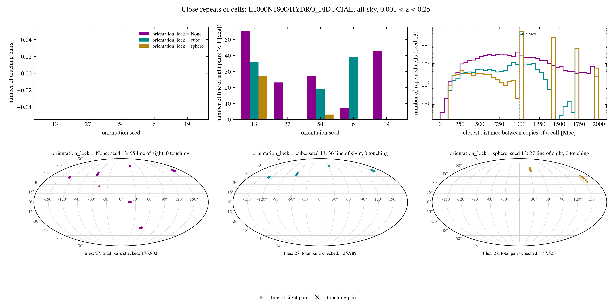

Repeated particles and haloes
==============================

A lightcone built from the snapshots holds **many copies of the same particles and haloes**, each tile in the lightcone 
is a copy of a snapshot box, so every halo in a given snapshot can appear once in every tile populated from that 
snapshot. This periodic replication results in the same structures being reproduced along a given line of sight and 
inherently biases the distribution of matter in any of the lightcones. 

.. Tip::
    **Before continuing**, see :doc:`orientation` to read up on how the lightcones are built with a regular lattice of 
    tiles, that can be organised into periodic layers by controlling the orientation of individual tiles. 

There are three scenarios of periodic replications that you should be aware of:    

#.  **Exact perodic replicas** If the tiles added into the lightcone are not reorientated then all tiles are exact 
    replicas of and the same structures can consistently reappear along the line of sight in all directions. This 
    can be avoided by simply changing the orientation of neighbouring tiles. To build a lightcone where all structure is 
    replicated every snapshot sidelength, use the installed ``"no_reorientation"`` tables (see
    :doc:`orientation_tables`).

#.  **Clashes due to different orientations** Where two neighbouring tiles are oriented differently, a SWIFT cell can 
    end up being in contact with **its own copy** (the same cell index of the snapshot box) in the other tile, resulting 
    in the same structures sit side by side. The two copies can be filled by the **same snapshot**, or by 
    **adjacent snapshots** where the boundary between their redshift ranges passes between them. Both are 
    :term:`clashes <clash>`, and both are called :term:`clashing pairs <clashing pair>` in these docs. Which cells clash 
    depends only on the orientation table, the ``orientation_lock``, the ``orientation_seed`` and the number of cells 
    per axis. When the orientation lock is either set as ``"cube"`` or ``"sphere"``  this cannot occur within the same 
    layer (a layer is one continuous periodic boundary); without a lock it can happen at any tile face. Clashes can be 
    avoided by the choice of orientation table (see :ref:`tables keeping copies apart <tables-keeping-copies-apart>`).

#.  **Close replicas along a line of sight.** Where the orientation changes, instead of all objects being periodically 
    replicated each box sidelength, replicas of a given object can lie in **nearly the same direction, less than a box 
    length apart along a given line of sight**. Therefore in some given direction an object can be repeated more often 
    than each box length. This can happen at every tile face without a lock, at every layer with ``"sphere"``, and only 
    between layers with ``"cube"``, but never within a layer. Unlike the clashing cells mentioned above, this cannot be 
    avoided, only reduced (with ``"cube"``, and by choosing the seed). 
    Keep this in mind for any measurement along lines of sight, or on scales comparable to the snapshot boxes sidelength.

.. Note::
    The occurrence of close replicas along a line of sight increases with smaller snapshot boxes, as more tiles
    (i.e. replications of the snapshots box's comoving volume) are fit into the same lightcone (see :ref:`small-boxes`).  

.. _fig-clashing-cells:

The figures below show a clash between two neighbouring tiles, A and B, in a slice through one layer of cells, every
cell coloured and numbered by its place in the snapshot box so its two copies can be matched.

.. grid:: 3 1 1 1
   :gutter: 2

   .. grid-item::

      .. figure:: images/snapshot_clashing_cells_replica.png
         :width: 55%
         :align: center
         :alt: Two copies of a 4 by 4 slice of cells, numbered 0 to 15, side by side with a gap between them.
      
         Tiles A and B: two copies of the snapshot box, before either is re-oriented.
   
   .. grid-item::

      .. figure:: images/snapshot_clashing_cell_clash.png
         :width: 55%
         :align: center
         :alt: Tile B, a mirror image of tile A, placed against it, with cells 12 to 15 meeting their own copies.
      
         **A clash:** tile B is tile A reflected along :math:`x`, placed against it. The four cells on the shared face
         (12 to 15) meet their own copies, so the same structures sit side by side: a :term:`clashing pair` for each.

   .. grid-item::

      .. figure:: images/snapshot_clashing_cell_no_clash.png
         :width: 55%
         :align: center
         :alt: Tile B, turned and shifted, placed against tile A, with the two copies of cell 11 half a box apart.
      
         **No clash:** tile B is tile A turned a quarter about :math:`z` and shifted by a quarter of the box along
         :math:`x`. No cell meets its own copy across the shared face; the closest two copies of a cell (cell 11) are half a
         box length apart. The default orientation table (``default_v2``) is made of rows that never clash across a tile
         face like this (see :doc:`orientation_tables`).

How many times an object appears
--------------------------------

Take a snapshot *s*. Call its part of the lightcone (its redshift range, within the beam) :math:`V_s`, and the box size 
:math:`L`.

*   **Exactly:** an object of snapshot *s* appears once in each tile of *s* where its copy lies inside :math:`V_s`, and 
    never twice in one tile.
*   **On average:** each object appears :math:`V_s / L^3` times. This is the same for every ``orientation_lock``, because 
    the tiles of *s* cover :math:`V_s` exactly once. The locks change where the copies are, not how many there are.
*   **At most** (in the whole lightcone):

.. list-table::
   :header-rows: 1

   * - ``orientation_lock``
     - An object of snapshot *s* appears at most

   * - ``None``
     - once per tile :math:`V_s` crosses

   * - ``"cube"``
     - once per tile :math:`V_s` crosses 
       (a tile is never split)

   * - ``"sphere"``
     - once per (tile, layer) piece: a tile crossing
       a layer sphere is used once for each layer

Repeats along a line of sight
-----------------------------

Within a region of the same orientation (one tile without a lock, one cube layer, or one sphere layer) the tiles are the
same box, forming one continuous periodically repeating layer. In such a region all objects are then replicated every 
whole box sidelength. Meaning the length between each replica (:math:`\lambda`) is equal to the snapshots 
sidelength (:math:`L`) when looking along the axis of the snapshots sidelength, :math:`\sqrt{2}L` along a face diagonal 
and :math:`\sqrt{3}L` along the longest diagonal within the snapshots box. 
For a distance of :math:`\Delta r` along a line-of-sight, a region of the same orientation can have, at most, 
:math:`\lfloor \Delta r / \lambda \rfloor + 1` copies of an object.

Where the orientation between tiles changes, the same object can land at unrelated positions on either side of where the 
orientation changes, including ones in nearly the same direction and closer than a box length:

.. list-table::
   :header-rows: 1

   * - ``orientation_lock``
     - The orientation changes at
     - Close repeats along a line of sight

   * - ``None``
     - every tile face
     - can happen at every tile face

   * - ``"cube"``
     - the faces between the cubic layers, 
     
       :math:`\max(|n_x|, |n_y|, |n_z|) = n + \frac{1}{2}`
     - never within a layer; can happen where the line of 
       sight passes into the next layer

   * - ``"sphere"``
     - the spherical layers, 
       :math:`r = (n + \frac{1}{2})L`
     - can happen at every layer, on both sides of where the
       sphere passes through a tile.  

Along a line of sight, an object can therefore appear up to once more than the periodic count for
every change of orientation the line of sight crosses within its snapshot's redshift range.

.. _small-boxes:

Small boxes
-----------

Smaller snapshot boxes repeat more frequently along a given line of sight due to the smaller sidelength and as a result 
one snapshots redshift range can cover more than one tile. To illustrate this the table below shows, for a 
single snapshot at redshift 0.1, the thickness (:math:`r(z_1) - r(z_0)`) of the lightcone shell that it populates in 
units of the snapshots sidelength. 

.. list-table::
   :header-rows: 1

   * - Box (sidelength)
     - Thickness of the lightcone shell

       populated by a snapshot at :math:`z=0.1`

   * - FLAMINGO L1

       (:math:`L=1000` Mpc; :math:`\Delta z = 0.05`)
     - :math:`\approx 0.2\, L`

   * - COLIBRE L200

       (:math:`L=200` Mpc; :math:`\Delta z = 0.02`)
     - :math:`\approx 0.42\, L`

   * - COLIBRE L50

       (:math:`L=50` Mpc)
     - :math:`\approx 1.7 \,L`

   * - COLIBRE L25

       (:math:`L=25` Mpc)
     - :math:`\approx 3.6\, L`

So in ``L25`` and ``L50``, every line of sight passes through the same snapshot box several times, even within one cube 
layer: the same structures repeat periodically, a box length apart, before the next snapshot takes over. This is the 
periodic repetition of the box, not a fault of the placement, but it is much stronger than in the large boxes. Varying 
the ``orientation_seed`` changes which structures repeat, but not how often.

.. _checking-a-lightcone-for-close-repeats-before-building-it:

Checking a lightcone for close repeats before building it
---------------------------------------------------------

:func:`find_close_cell_repeats <swiftlet.repeat_check.find_close_cell_repeats>` finds :term:`close repeats <close repeat>` 
early, at the level of SWIFT cells, for any simulation, orientation table, ``orientation_lock`` and ``orientation_seed``. 
It builds lightcone shells from the position of the cell centres only and reads no particles. For each 
(snapshot, tile) :term:`piece` of the lightcone, it moves every cell into the corresponding tile and keeps the cells 
overlapping that tile's part of the lightcone. It then compares pairs of each cell, and reports:

* **clashing pairs**: two copies of the same cell sharing a face, so the same structures sit 
  side by side. Each pair from is counted once. With ``orientation_lock="sphere"`` this includes the 
  clashes of cells across the spherical layers inside of a tile.  
  :func:`find_close_cell_repeats <swiftlet.repeat_check.find_close_cell_repeats>` pairs the copies of a cell. Copies of 
  the same cell from adjacent snapshots can also touch, where the boundary between the snapshots' redshift ranges 
  crosses the face between two tiles, and it does not report those.
* **line of sight pairs**: two copies of the same cell that could hold copies of the same particles 
  (and therefore haloes), where the cell centres are within a given angular separation ``angle_deg`` (1° by default) on 
  the sky and closer than ``max_los_separation`` (a box length by default). These choices are conservative as the angle
  is widened by each cell's angular size and the distance by a cell diagonal, so every such pair of particles is in a 
  reported pair of cells.

.. code-block:: python

    from swiftlet import SnapshotAllSky, find_close_cell_repeats

    lightcone = SnapshotAllSky(simulation=Simulation.from_label("L1000N1800", "HYDRO_FIDUCIAL"), 
                                  orientation_lock="cube", orientation_seed=0)
    report = find_close_cell_repeats(lightcone, (0.05, 0.4), output_file="close_repeats.hdf5")
    print(report.summary())

If anything is found by :func:`find_close_cell_repeats <swiftlet.repeat_check.find_close_cell_repeats>` it 
warns you with a :class:`CloseRepeatWarning <swiftlet.repeat_check.CloseRepeatWarning>`. The report holds the counts 
(and the size of the shell checked: the number of tiles, of cells and cell copies, and of pairs of copies of the same 
cell, every pair that could be a close repeat), the pairs (snapshot, cell, both tiles, both centres, their separation, 
angle and difference in distance) and, for every repeated cell, its number of copies and the closest distance to its own 
copies. ``output_file`` writes these to an HDF5 file, with the lightcone's settings and ``max_separation`` reports every 
pair of copies closer than that.

For a quicker check you can use the orientation tables by themselves with 
:func:`check_neighbouring_tiles <swiftlet.snapshot_orientation.check_neighbouring_tiles>` which finds clashes of cells 
between neighbouring tiles based on the rows of the tables (see :ref:`Orientation tables <checking-tables-for-clashes>`). 

Visualising line-of-sight pairs
^^^^^^^^^^^^^^^^^^^^^^^^^^^^^^^

The example `snapshot_close_repeat_check.py <https://github.com/Will-McD/ExtraSWIFTLightcones/blob/main/examples/snapshot_close_repeat_check.py>`_ 
runs it for every lock and several seeds and returns a summary plot, which is shown below for the fiducial 
FLAMINGO L1_m9 simulation:

.. _fig-summary-plot:

   Summary plot output from running the example:  `snapshot_close_repeat_check.py <https://github.com/Will-McD/ExtraSWIFTLightcones/blob/main/examples/snapshot_close_repeat_check.py>`_ 
   which uses the default table, which doesn't allow for replicas of the same cell in adjacent tiles to be in contact.
   The all-sky maps show the location of the **line of sight pairs** relative to the observer, for ``orientation_lock`` 
   with ``orientation_seed=13``, purposefully selected for this example to show multiple pairs for each 
   ``orientation_lock``.

The :ref:`figure <fig-pairs-on-sky>` below shows the projection of all pairs of cells identified by 
:func:`check_neighbouring_tiles <swiftlet.snapshot_orientation.check_neighbouring_tiles>` for an all-sky lightcone that 
spans redshifts :math:`z=0 - 1` of the fiducial L1_m9 FLAMINGO simulation, generated with each ``orientation_lock`` 
(``"None"``, ``"cube"`` and ``"sphere"``) and orientation table (``default_v2``, ``cube_quarter_spacing`` and 
``sphere_quarter_spacing``) for the same seed, ``orientation_seed=7``.  
Each point on the Mollweide projections corresponds to a pair of the same cells that are within 1° of each other on the 
sky, where the colour indicates both the orientation lock and minimum distance between the cell pairs. 

.. _fig-pairs-on-sky:

.. grid:: 1 2 2 2
   :gutter: 2

   .. grid-item::

      .. figure:: images/default_skymap.png
         :width: 100%

         The projection of line-of-sight pairs for ``orientation_table="default_v2"``. As described in 
         :doc:`orientation_tables`, with this set of orientations there are no clashes between pairs for when 
         ``orientation_lock="cube"`` (blues) and ``"none"`` (greens). 

   .. grid-item::

      .. figure:: images/cube_skymap.png
         :width: 100%

         The projection of line-of-sight pairs for ``orientation_table="cube_quarter_spacing"``. All pairs for when 
         ``orientation_lock="cube"`` (blues) and ``orientation_lock="none"`` (greens) are separated by at least 250 Mpc
         (a quarter of the snapshots sidelength), which is not true for when ``orientation_lock="sphere"`` (reds) as 
         described in :doc:`orientation_tables`. 

   .. grid-item::

      .. figure:: images/sphere_skymap.png
         :width: 100%

         The projection of line-of-sight pairs for ``orientation_table="sphere_quarter_spacing"``. All pairs identified,
         for each orientation lock, even if within 1° of each other on the sky are still separated by at least a quarter 
         of the snapshots sidelength. 

   .. grid-item::

